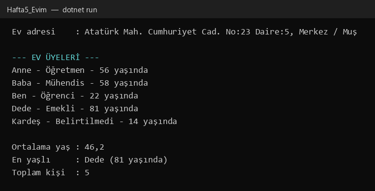
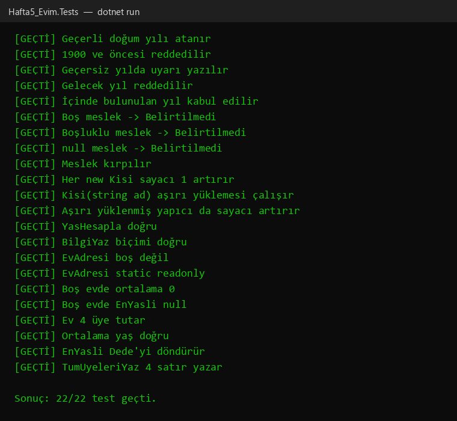

# Hafta 5 — Evim (Sınıflar, Yapıcı Metotlar ve Statik Üyeler)

Bir evi ve içindeki kişileri modelleyen C# / .NET 10 konsol uygulaması.

| | |
|---|---|
| **Öğrenci** | Abdulkadir Demir |
| **Öğrenci numarası** | 240541007 |
| **Ders** | Nesne Tabanlı Programlama (YMH219) |
| **Föy** | [docs/Hafta5_Foy.pdf](docs/Hafta5_Foy.pdf) |

## Teslim dosyaları

- [Word raporu](teslim/Hafta5_NTP_Odev.docx)
- [PDF raporu](teslim/Hafta5_NTP_Odev.pdf)
- [Kaynak kod ZIP](teslim/240541007_NTP_Hafta5.zip)

## Kendi Göreviniz: yapılanlar

| # | Görev | Çözüm |
|---|---|---|
| 1 | Meslek doğrulamalı property | `set` içinde `string.IsNullOrWhiteSpace` kontrolü yapılıyor. Boş, sadece boşluk ya da `null` gelirse `"Belirtilmedi"` atanıyor. |
| 2 | `public Kisi EnYasli()` | `Ev` sınıfında en büyük `YasHesapla()` değerine sahip üye döndürülüyor. Ev boşsa `null` dönüyor. |
| 3 | Ev adresi | `public static readonly string EvAdresi` tanımlandı, Main'de `Kisi.EvAdresi` ile yazdırılıyor. |
| 4 | En az 4 kişi | 5 kişi eklendi (biri boş meslekle). Üyeler, ortalama yaş, en yaşlı ve toplam kişi yazdırılıyor. |
| Ek | Yapıcı metot aşırı yüklemesi (8. bölüm) | `Kisi(string ad)` yapıcısı `this(...)` ile üç parametreli yapıcıyı çağırıyor. |

## Çalıştırma

```powershell
dotnet run --project Hafta5_Evim.csproj
dotnet run --project tests/Hafta5_Evim.Tests   # 22 davranış testi
```

Visual Studio'da `Hafta5_Evim.sln` dosyasını açıp **F5** ile de çalıştırabilirsiniz.

## Çıktı



Yaşlar içinde bulunulan yıla göre hesaplanıyor. Metin hâli için: [Konsol_Ciktisi.txt](Konsol_Ciktisi.txt).

## Testler



## Dosyalar

```
Hafta5_Evim/
├── Kisi.cs              # property'ler, doğrulama, yapıcılar, statik sayaç, EvAdresi
├── Ev.cs                # List<Kisi>, UyeEkle, TumUyeleriYaz, OrtalamaYas, EnYasli
├── Program.cs           # Main: evi kurma ve çıktılar
├── tests/               # paket gerektirmeyen davranış testleri
├── docs/                # föy ve ekran görüntüleri
└── teslim/              # Word, PDF, ZIP
```
