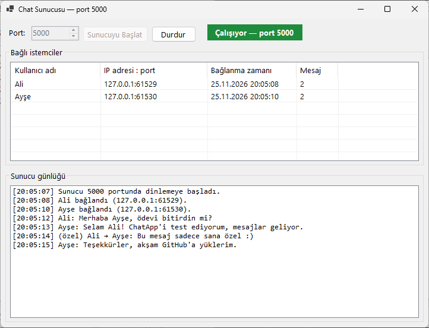
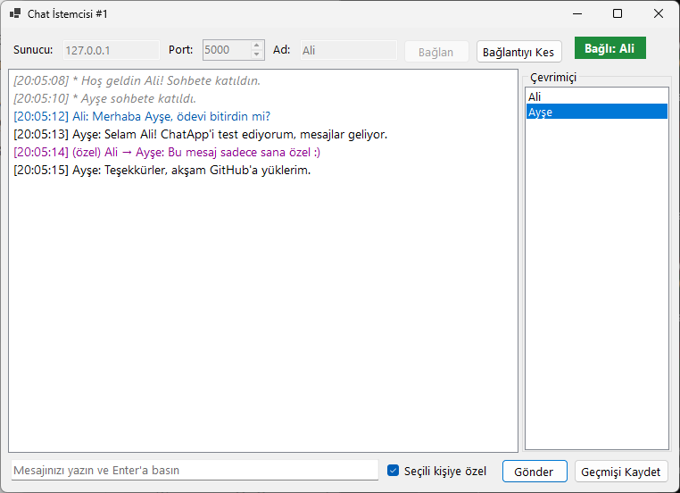

# YMH219-ChatApp — İstemci-Sunucu Sohbet Uygulaması

`TcpListener` / `TcpClient` ile çalışan, aynı bilgisayarda veya aynı yerel ağda birden fazla istemcinin
mesajlaşabildiği Windows Forms sohbet uygulaması. Ağ işlemleri `async/await` ile yapılır; arayüz donmaz.
Nesne Tabanlı Programlama (YMH 219) dersi ek uygulama ödevidir.

| | |
|---|---|
| **Öğrenci** | Abdulkadir Demir |
| **Öğrenci numarası** | 240541007 |
| **Ders** | Nesne Tabanlı Programlama (YMH 219) |

## Ekran Görüntüleri

**Sunucu:** bağlı istemcilerin kullanıcı adı, IP:port, bağlanma zamanı ve mesaj sayısı + sunucu günlüğü



| İstemci (Ayşe) — genel sohbet | İstemci (Ali) — özel mesaj (mor) ve çevrimiçi listesi |
|---|---|
|  |  |

## Kullanılan Teknolojiler

- C# 12, .NET 8, Windows Forms
- `System.Net.Sockets` — `TcpListener`, `TcpClient`, `NetworkStream`
- `StreamReader.ReadLineAsync` / `StreamWriter.WriteLineAsync` — satır tabanlı protokol
- `System.Text.Json` — her mesaj tek satırlık JSON olarak gönderilir
- `async/await`, `CancellationToken`, `SemaphoreSlim`, `ConcurrentDictionary`
- **Harici NuGet paketi yoktur.**

## Kurulum ve Çalıştırma

Gereksinim: Windows 10/11 ve [.NET 8 SDK](https://dotnet.microsoft.com/download/dotnet/8.0) veya Visual Studio 2022.

```powershell
git clone https://github.com/kdemirwarehouse/YMH219-ChatApp.git
cd YMH219-ChatApp
dotnet run --project src/ChatApp
```

Visual Studio ile: `ChatApp.sln` → başlangıç projesi `ChatApp` → **F5**.

**Aynı bilgisayarda deneme**

1. Açılış penceresinde **Sunucu Penceresi** → port (varsayılan 5000) → **Sunucuyu Başlat**.
2. **Yeni İstemci** ile iki veya daha fazla istemci açın.
3. Her istemcide sunucu `127.0.0.1`, port `5000`, bir kullanıcı adı yazıp **Bağlan**.

Doğrudan açmak için: `ChatApp.exe --sunucu` veya `ChatApp.exe --istemci`.

**Yerel ağda deneme:** Sunucuyu bir bilgisayarda başlatın; diğer bilgisayardaki istemcide sunucu adresi olarak
o bilgisayarın IP'sini (`ipconfig` → IPv4) yazın. Windows Güvenlik Duvarı ilk çalıştırmada izin isteyebilir.

**Testler:** `dotnet run --project tests/ChatApp.Tests` — gerçek TCP bağlantılarıyla 10 test.

## Temel Özellikler

- **Sunucu:** başlat / durdur, port seçimi; bağlanan istemcilerin listesi (kullanıcı adı, IP:port, bağlanma zamanı, mesaj sayısı); olay günlüğü
- **İstemci:** kullanıcı adıyla **Bağlan**, **Mesaj Gönder** (Enter), **Bağlantıyı Kes**
- Gönderilen ve alınan mesajlar **zaman bilgisiyle** gösterilir; mesaj türüne göre renklendirilir
- Bağlantı durumu göstergesi (Bağlı değil / Bağlanıyor... / Bağlı: ad)
- **Hata yönetimi** — uygulama kapanmadan kullanıcıya bildirilir:
  - Sunucu çalışmıyorsa "bağlantı reddedildi" mesajı, bağlanırken 5 sn zaman aşımı
  - Port kullanımdaysa sunucu başlatılamadı mesajı
  - Sunucu kapanırsa / bağlantı koparsa istemcide uyarı ve arayüz bağlı değil durumuna döner
  - Aynı kullanıcı adı, boş veya çok uzun ad reddedilir
  - Bir istemcinin kopması diğer istemcileri etkilemez
- **İsteğe bağlı geliştirmeler**
  - Birden fazla istemci aynı odada (herkese yayın)
  - **Özel mesaj** — çevrimiçi listesinden kullanıcı seçip "Seçili kişiye özel"
  - **Mesaj geçmişini .txt dosyasına kaydetme**
  - Katıldı / ayrıldı bildirimleri ve canlı çevrimiçi listesi

## Protokol

Her mesaj tek satır JSON'dur (satır sonu = mesaj sonu):

```json
{"Tur":"Sohbet","Gonderen":"Ali","Metin":"Merhaba","Zaman":"2026-11-25T20:05:12+03:00"}
```

Türler: `Katil`, `Sohbet`, `Ozel`, `Sistem`, `KullaniciListesi`, `Hata`. İstemcinin ilk mesajı `Katil` olmalıdır.
Gönderen adı ve zaman **sunucu tarafından** atanır; bir istemci başkası adına mesaj gönderemez.

## Proje Yapısı

```
YMH219-ChatApp/
├── ChatApp.sln
├── src/
│   ├── ChatApp.Core/               Ağ katmanı (arayüzden bağımsız)
│   │   ├── ChatMesaji.cs           Mesaj modeli + JSON dönüşümü
│   │   ├── JsonSatirBaglantisi.cs  TcpClient üzerinde satır okuma/yazma
│   │   ├── ChatSunucu.cs           TcpListener, istemci yönetimi, yayın, özel mesaj
│   │   └── ChatIstemci.cs          Bağlanma, gönderme, arka planda okuma
│   └── ChatApp/                    Windows Forms
│       ├── BaslangicForm.cs        Sunucu / istemci seçimi
│       ├── SunucuForm.cs
│       └── IstemciForm.cs
├── tests/ChatApp.Tests/
└── docs/screenshots/
```

Ayrıntılı açıklama: [KOD-REHBERI.md](KOD-REHBERI.md)

## Bilinen Sınırlamalar / Geliştirme Notları

- Mesajlar şifrelenmez (TLS yok); yalnızca ders/yerel ağ kullanımı içindir.
- Tek bir sohbet odası vardır; kullanıcı doğrulaması (parola) yoktur.
- Sunucu kapanınca geçmiş saklanmaz; geçmiş yalnızca istemcide "Geçmişi Kaydet" ile dosyaya yazılabilir.
- İstemci kopunca otomatik yeniden bağlanma yoktur; kullanıcı tekrar **Bağlan**'a basmalıdır.
