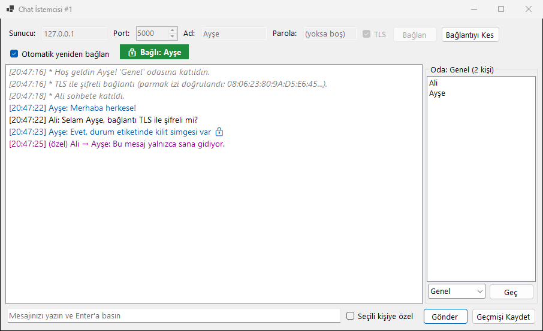
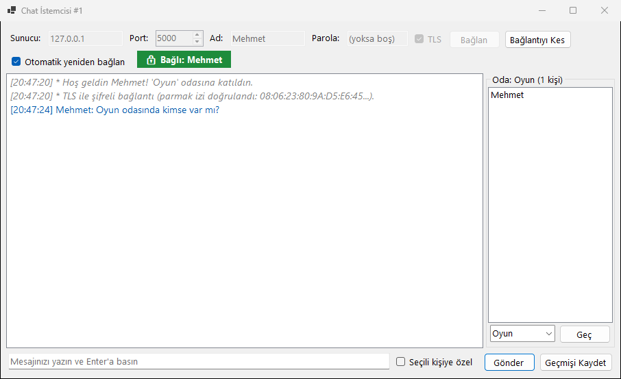

# YMH219-ChatApp — İstemci-Sunucu Sohbet Uygulaması

`TcpListener` / `TcpClient` ile çalışan, aynı bilgisayarda veya aynı yerel ağda birden fazla istemcinin
mesajlaşabildiği Windows Forms sohbet uygulaması. Ağ işlemleri `async/await` ile yapılır; arayüz donmaz.
Nesne Tabanlı Programlama (YMH 219) dersi ek uygulama ödevidir.

| | |
|---|---|
| **Öğrenci** | Abdulkadir Demir |
| **Öğrenci numarası** | 240541007 |
| **Ders** | Nesne Tabanlı Programlama (YMH 219) |

### ▶ Tarayıcı demosu: **https://kdemirwarehouse.github.io/YMH219-ChatApp/**

Statik GitHub Pages'te TCP sunucusu çalıştırılamadığından web demosu (`web/index.html`) aynı JSON protokolünü
**aynı tarayıcıdaki sekmeler arasında** `BroadcastChannel` ile taşır: kullanıcı adı, odalar, özel mesaj, çevrimiçi listesi,
oda geçmişi (`localStorage`) ve `.txt` kaydetme çalışır. İkinci kullanıcı için sayfadaki **+ Yeni sekme** düğmesini kullanın.
Gerçek ağ üzerinden (TLS'li) sohbet için masaüstü uygulaması kullanılır.

## Ekran Görüntüleri

**Sunucu:** TLS açık; bağlı istemcilerin kullanıcı adı, IP:port, bağlanma zamanı, **odası** ve mesaj sayısı + sunucu günlüğü


| İstemci (Ayşe) — 🔒 TLS, parmak izi doğrulandı | İstemci (Ali) — geçmiş mesaj (soluk) ve özel mesaj (mor) |
|---|---|
|  |  |

**Ayrı oda:** Mehmet *Oyun* odasında; *Genel* odasının mesajlarını görmez.



## Kullanılan Teknolojiler

- C# 12, .NET 8, Windows Forms
- `System.Net.Sockets` — `TcpListener`, `TcpClient`, `NetworkStream`
- `StreamReader.ReadLineAsync` / `StreamWriter.WriteLineAsync` — satır tabanlı protokol
- `System.Text.Json` — her mesaj tek satırlık JSON olarak gönderilir
- `async/await`, `CancellationToken`, `SemaphoreSlim`, `ConcurrentDictionary`
- `System.Net.Security.SslStream`, `CertificateRequest` (kendinden imzalı X.509 sertifika), `SHA256`
- **Harici NuGet paketi yoktur.**

## Kurulum ve Çalıştırma

Gereksinim: Windows 10/11 ve [.NET 8 SDK](https://dotnet.microsoft.com/download/dotnet/8.0) veya Visual Studio 2022.

```powershell
git clone https://github.com/kdemirwarehouse/YMH219-ChatApp.git
cd YMH219-ChatApp
dotnet run --project src/ChatApp
```

Visual Studio ile: `ChatApp.sln` → başlangıç projesi `ChatApp` → **F5**.

**Aynı bilgisayarda deneme**

1. Açılış penceresinde **Sunucu Penceresi** → port (varsayılan 5000) → **Sunucuyu Başlat**.
2. **Yeni İstemci** ile iki veya daha fazla istemci açın.
3. Her istemcide sunucu `127.0.0.1`, port `5000`, bir kullanıcı adı yazıp **Bağlan**.

Doğrudan açmak için: `ChatApp.exe --sunucu` veya `ChatApp.exe --istemci`.

**Yerel ağda deneme:** Sunucuyu bir bilgisayarda başlatın; diğer bilgisayardaki istemcide sunucu adresi olarak
o bilgisayarın IP'sini (`ipconfig` → IPv4) yazın. Windows Güvenlik Duvarı ilk çalıştırmada izin isteyebilir.

**Testler:** `dotnet run --project tests/ChatApp.Tests` — gerçek TCP bağlantılarıyla 17 test.

## Temel Özellikler

- **Sunucu:** başlat / durdur, port seçimi; bağlanan istemcilerin listesi (kullanıcı adı, IP:port, bağlanma zamanı, mesaj sayısı); olay günlüğü
- **İstemci:** kullanıcı adıyla **Bağlan**, **Mesaj Gönder** (Enter), **Bağlantıyı Kes**
- Gönderilen ve alınan mesajlar **zaman bilgisiyle** gösterilir; mesaj türüne göre renklendirilir
- Bağlantı durumu göstergesi (Bağlı değil / Bağlanıyor... / Bağlı: ad)
- **Hata yönetimi** — uygulama kapanmadan kullanıcıya bildirilir:
  - Sunucu çalışmıyorsa "bağlantı reddedildi" mesajı, bağlanırken 5 sn zaman aşımı
  - Port kullanımdaysa sunucu başlatılamadı mesajı
  - Sunucu kapanırsa / bağlantı koparsa istemcide uyarı ve arayüz bağlı değil durumuna döner
  - Aynı kullanıcı adı, boş veya çok uzun ad reddedilir
  - Bir istemcinin kopması diğer istemcileri etkilemez
- **İsteğe bağlı geliştirmeler**
  - **Sohbet odaları:** istemci bağlanırken oda adı seçer (varsayılan *Genel*), sağ paneldeki kutudan başka bir odaya
    **Geç**ebilir veya yeni oda açabilir. Sohbet mesajları ve katıldı/ayrıldı bildirimleri yalnızca aynı odaya gider;
    çevrimiçi listesi odanın üyelerini, açılır liste aktif odaları gösterir. Her odanın geçmişi ayrı tutulur.
    Özel mesaj odadan bağımsızdır. Sunucu listesinde her istemcinin odası görünür.
  - **Özel mesaj** — çevrimiçi listesinden kullanıcı seçip "Seçili kişiye özel"
  - **Mesaj geçmişini .txt dosyasına kaydetme**
  - Katıldı / ayrıldı bildirimleri ve canlı çevrimiçi listesi
  - **TLS ile şifreli bağlantı (varsayılan açık):** sunucu ilk açılışta kendinden imzalı bir RSA-2048 sertifika üretir
    (`%LOCALAPPDATA%\YMH219-ChatApp\sunucu-sertifikasi.pfx`) ve tüm trafiği `SslStream` ile (TLS 1.2/1.3) şifreler.
    İstemci sertifikanın SHA-256 parmak izini ilk bağlantıda kaydeder (**TOFU**, SSH `known_hosts` mantığı:
    `bilinen-sunucular.txt`); sonraki bağlantılarda parmak izi değişirse "GÜVENLİK UYARISI" ile bağlantıyı reddeder.
    Durum göstergesinde 🔒 simgesi ve sohbette parmak izi görünür. TLS kutusu kapatılarak eski şifresiz mod kullanılabilir.
  - **Sunucu parolası (kullanıcı doğrulama):** sunucu parola ile başlatılırsa istemciler bağlanırken aynı parolayı
    girmelidir. Karşılaştırma SHA-256 özetleri üzerinde `CryptographicOperations.FixedTimeEquals` ile sabit zamanlı yapılır;
    yanlış denemeden sonra 1 sn beklenir. Parola hiçbir zaman yayınlanmaz veya günlüğe yazılmaz.
  - **Kalıcı sunucu geçmişi:** herkese açık mesajlar ve katıldı/ayrıldı bildirimleri sunucuda
    `%LOCALAPPDATA%\YMH219-ChatApp\sohbet-gecmisi.jsonl` dosyasına (JSON Lines) yazılır; sunucu yeniden açılınca yüklenir.
    Yeni katılan kullanıcıya **son 50 mesaj** soluk renkte ve tarihli gönderilir. Özel mesajlar gizlilik gereği geçmişe yazılmaz.
    Sunucu penceresindeki **Geçmişi Sil** ile temizlenebilir.
  - **Otomatik yeniden bağlanma:** bağlantı beklenmedik şekilde koparsa (sunucu yeniden başlatıldı, ağ kesildi)
    istemci 1, 2, 4, 8… sn (en fazla 10 sn) arayla 10 kez yeniden bağlanmayı dener; durum göstergesinde deneme sayısı görünür.
    "Bağlantıyı Kes" döngüyü durdurur, istenirse "Otomatik yeniden bağlan" kutusuyla kapatılabilir.

## Protokol

Her mesaj tek satır JSON'dur (satır sonu = mesaj sonu):

```json
{"Tur":"Sohbet","Gonderen":"Ali","Metin":"Merhaba","Zaman":"2026-11-25T20:05:12+03:00"}
```

Türler: `Katil`, `Sohbet`, `Ozel`, `Sistem`, `KullaniciListesi`, `Hata`, `OdaDegistir`. İsteğe bağlı alanlar: `Oda`, `Odalar`, `Parola` (yalnızca `Katil`), `Gecmis`. İstemcinin ilk mesajı `Katil` olmalıdır.
Gönderen adı ve zaman **sunucu tarafından** atanır; bir istemci başkası adına mesaj gönderemez.

## Proje Yapısı

```
YMH219-ChatApp/
├── ChatApp.sln
├── src/
│   ├── ChatApp.Core/               Ağ katmanı (arayüzden bağımsız)
│   │   ├── ChatMesaji.cs           Mesaj modeli + JSON dönüşümü
│   │   ├── JsonSatirBaglantisi.cs  TcpClient üzerinde satır okuma/yazma
│   │   ├── ChatSunucu.cs           TcpListener, istemci yönetimi, yayın, özel mesaj
│   │   ├── MesajGecmisi.cs         Son mesajlar + JSON Lines dosyasında kalıcı geçmiş
│   │   ├── TlsYardimcisi.cs        Kendinden imzalı sertifika, parmak izi, TOFU deposu
│   │   └── ChatIstemci.cs          Bağlanma, gönderme, arka planda okuma
│   └── ChatApp/                    Windows Forms
│       ├── BaslangicForm.cs        Sunucu / istemci seçimi
│       ├── SunucuForm.cs
│       └── IstemciForm.cs
├── tests/ChatApp.Tests/
├── web/index.html                  Tarayıcı demosu (BroadcastChannel), GitHub Pages
├── .github/workflows/pages.yml     web/ klasörünü GitHub Pages'e deploy eden iş akışı
└── docs/screenshots/
```

Ayrıntılı açıklama: [KOD-REHBERI.md](KOD-REHBERI.md)

## Bilinen Sınırlamalar / Geliştirme Notları

- TLS sertifikası kendinden imzalıdır (CA yok); ilk bağlantıdaki parmak izi kullanıcı tarafından sunucuyla
  karşılaştırılmalıdır (sunucu günlüğünde ve istemcide görünür). Sertifika yenilenirse istemcideki
  `bilinen-sunucular.txt` satırı silinmelidir.
- Web demosu yalnızca aynı tarayıcıdaki sekmeler arasında çalışır (gerçek ağ sohbeti masaüstü sürümündedir).

