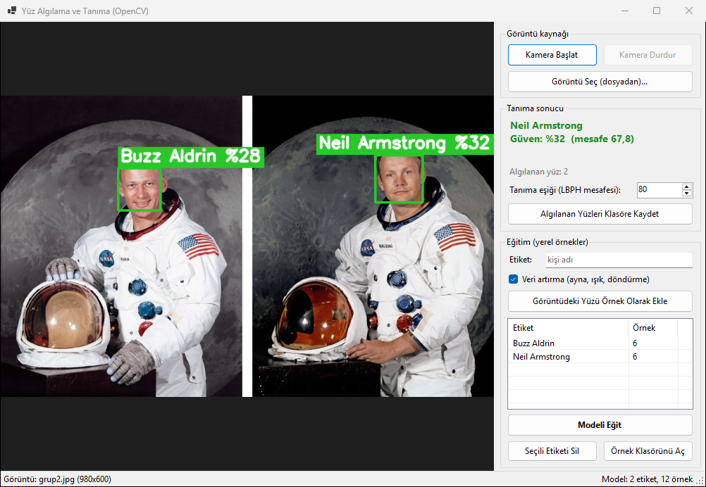
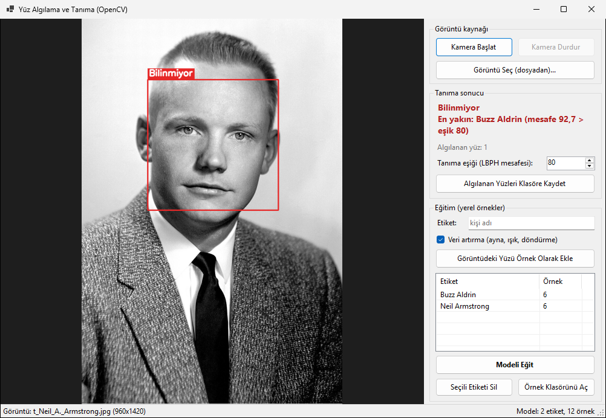

# YMH219-FaceRecognition — OpenCV ile Yüz Algılama ve Tanıma

OpenCvSharp4 kullanan bir Windows Forms uygulaması. Kameradan veya seçilen görüntü dosyasından alınan karede
yüzleri **Haar Cascade** ile algılar, dikdörtgenle işaretler ve kullanıcının oluşturduğu küçük yerel örnek kümesiyle
eğitilen **LBPH** modeliyle kişiyi etiketler. Tahmin edilen etiket ve güven skoru arayüzde gösterilir.
Nesne Tabanlı Programlama (YMH 219) dersi ek uygulama ödevidir.

| | |
|---|---|
| **Öğrenci** | Abdulkadir Demir |
| **Öğrenci numarası** | 240541007 |
| **Ders** | Nesne Tabanlı Programlama (YMH 219) |

## Ekran Görüntüleri

| İki etiketle eğitilmiş model — aynı karede iki yüz tanınıyor | Modelin hiç görmediği fotoğraf — eşik aşıldığı için "Bilinmiyor" |
|---|---|
|  |  |

Ekran görüntülerinde gönüllü yerine **kamuya açık (public domain) NASA portreleri** kullanılmıştır
(Buzz Aldrin ve Neil Armstrong resmi portreleri, Wikimedia Commons). Model her kişi için **tek bir fotoğraf** + veri artırma
ile eğitildi. Soldaki görüntüdeki yüzler eğitimde kullanılan fotoğraflardır; sağdaki 1956 tarihli siyah-beyaz fotoğraf
modelin hiç görmediği bir görüntüdür ve mesafe eşiği (80) aşıldığı için yanlış isim vermek yerine **"Bilinmiyor"** sonucu üretilmiştir.
Bu, az örnekle çalışan LBPH yönteminin gerçek davranışını gösterir (bkz. Bilinen Sınırlamalar).

## Kullanılan Teknolojiler / NuGet Paketleri

- C# 12, .NET 8 (`net8.0-windows`), Windows Forms
- **NuGet:**
  - `OpenCvSharp4` — OpenCV'nin .NET sarmalayıcısı (`Mat`, `CascadeClassifier`, `VideoCapture`, `OpenCvSharp.Face.LBPHFaceRecognizer`)
  - `OpenCvSharp4.runtime.win` — Windows için yerel OpenCV kütüphaneleri (contrib/face modülü dahil)
  - `OpenCvSharp4.Extensions` — `Mat` → `Bitmap` dönüşümü (PictureBox için)
- **Model:** `src/FaceRecognition/Models/haarcascade_frontalface_default.xml` (OpenCV ile dağıtılan önceden eğitilmiş yüz algılayıcı)

## Kurulum ve Çalıştırma

Gereksinim: Windows 10/11 (x64), [.NET 8 SDK](https://dotnet.microsoft.com/download/dotnet/8.0) veya Visual Studio 2022, isteğe bağlı web kamerası.

```powershell
git clone https://github.com/kdemirwarehouse/YMH219-FaceRecognition.git
cd YMH219-FaceRecognition
dotnet run --project src/FaceRecognition
```

Visual Studio ile: `FaceRecognition.sln` → başlangıç projesi `FaceRecognition` → **F5**. NuGet paketleri ilk derlemede otomatik indirilir.

**Testler:** `dotnet run --project tests/FaceRecognition.Tests` (9 test)

### Kullanım (en az iki etiketle tanıma)

1. **Kamera Başlat** veya **Görüntü Seç** — yüzler mavi dikdörtgenle işaretlenir (model henüz eğitilmedi).
2. **Etiket** kutusuna kişinin adını yazın (ör. `Ali`) → **Görüntüdeki Yüzü Örnek Olarak Ekle**.
   Kamerada başınızı hafifçe çevirip ışığı değiştirerek 5-10 kez tekrarlayın.
3. İkinci kişi (veya kendi yüzünüzün farklı bir görünümü, ör. `Ali-gozluklu`) için aynı işlemi yapın.
4. **Modeli Eğit** → artık yüzler yeşil (tanındı) veya kırmızı (bilinmiyor) çerçeveyle, etiket ve güven skoruyla gösterilir.

Örnekler `%LOCALAPPDATA%\YMH219-FaceRecognition\ornekler\<etiket>\` klasörlerinde saklanır, uygulama açılışında
model otomatik yeniden eğitilir. Örnek yüzler kişisel veri olduğu için **depoya yüklenmez** (`.gitignore`).

## Temel Özellikler

- **Kamera Başlat / Durdur** (arka plan görevinde kare okuma, arayüz donmaz) ve **Görüntü Seç** (jpg/png/bmp)
- Haar Cascade ile yüz algılama; **aynı karede birden fazla yüz** işaretlenir
- LBPH ile tanıma: tahmin edilen **etiket**, **güven skoru** ve LBPH **mesafesi** gösterilir
- Ayarlanabilir **tanıma eşiği**: mesafe eşikten büyükse "Bilinmiyor" (ve en yakın etiket bilgi olarak)
- **Basit eğitim / veri ekleme ekranı**: etiket yazıp örnek ekleme, etiket listesi ve örnek sayıları, etiket silme, örnek klasörünü açma
- **Veri artırma**: her örnekten ayna, aydınlık/karanlık ve ±8° döndürülmüş kopyalar üretilir (1 örnek → 6 görüntü)
- **Algılanan yüzleri ayrı klasöre kaydetme** (`...\YMH219-FaceRecognition\algilanan\`)
- **Hata yönetimi**: kamera yok / meşgul / izin kapalı, model dosyası eksik veya bozuk, OpenCV yerel kütüphanesi yüklenemedi,
  görüntü açılamadı, eğitim için yetersiz etiket — hepsi kullanıcıya mesajla bildirilir, uygulama kapanmaz

## Proje Yapısı

```
YMH219-FaceRecognition/
├── FaceRecognition.sln
├── src/
│   ├── FaceRecognition.Core/        OpenCV'den bağımsız, test edilebilir mantık
│   │   ├── EtiketKurallari.cs       Etiket (kişi adı) doğrulama
│   │   ├── TanimaKarari.cs          Mesafe + eşik → etiket / Bilinmiyor, güven yüzdesi
│   │   └── OrnekDeposu.cs           ornekler/<etiket>/001.png klasör yönetimi, etiket Id'leri
│   └── FaceRecognition/
│       ├── Services/GoruntuServisi.cs  Haar algılama, yüz hazırlama, veri artırma, LBPH eğitim/tahmin, çizim
│       ├── Services/KameraServisi.cs   VideoCapture ile arka planda kare okuma
│       ├── Models/haarcascade_frontalface_default.xml
│       ├── MainForm.cs / MainForm.Designer.cs
│       └── Program.cs               --ornekler / --resim parametreleri
├── tests/FaceRecognition.Tests/
└── docs/screenshots/
```

Ayrıntılı açıklama: [KOD-REHBERI.md](KOD-REHBERI.md)

## Kapsam ve Güvenlik Sınırı

Bu çalışma yalnızca ders kapsamında, **yerel ve gönüllü örneklerle** kullanılmak içindir. Görüntüler ve örnekler
yalnızca yerel diskte tutulur; ağ üzerinden hiçbir veri gönderilmez. Kamuya açık alanlarda izinsiz kimlik takibi,
gizli görüntü toplama veya kişileri uzaktan izleme amacıyla kullanılmamalıdır.

## Bilinen Sınırlamalar / Geliştirme Notları

- **LBPH az örnekle sınırlıdır.** Aynı kişinin çok farklı ışık/yaş/renk koşulundaki fotoğrafında mesafe büyür ve sonuç
  "Bilinmiyor" olur (2. ekran görüntüsü). Kişi başına kameradan farklı açılarla 10+ örnek eklemek doğruluğu belirgin artırır.
  Eşik düşük tutulduğu için sistem emin olmadığında yanlış isim vermek yerine "Bilinmiyor" der.
- **Haar Cascade** önden bakan yüzlerde iyi çalışır; profil yüzleri kaçırabilir, karmaşık desenli arka planlarda nadiren
  yanlış pozitif üretebilir. Daha iyi sonuç için OpenCV DNN (YuNet) yüz algılayıcısı kullanılabilir.
- Güven yüzdesi (`100 − mesafe`) gösterim amaçlı basit bir ölçektir, olasılık değildir.
- OpenCV'nin yerleşik yazı tipi Türkçe karakter desteklemediği için görüntü üzerindeki etiketlerde Türkçe harfler sadeleştirilir
  (ör. "Ayşe" → "Ayse"); sağdaki panelde doğru yazılır.

## Üçüncü Taraf Bileşenler

- OpenCV ve OpenCvSharp — Apache 2.0 lisansı
- `haarcascade_frontalface_default.xml` — Intel License Agreement (dosya başlığında), OpenCV deposundan
- Ekran görüntülerindeki fotoğraflar — NASA, kamu malı (public domain); depoya eklenmemiştir
