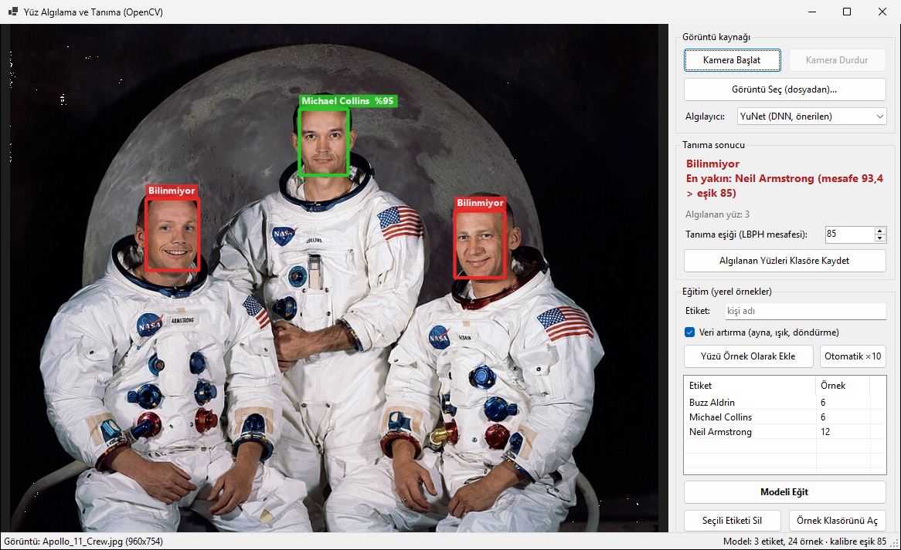
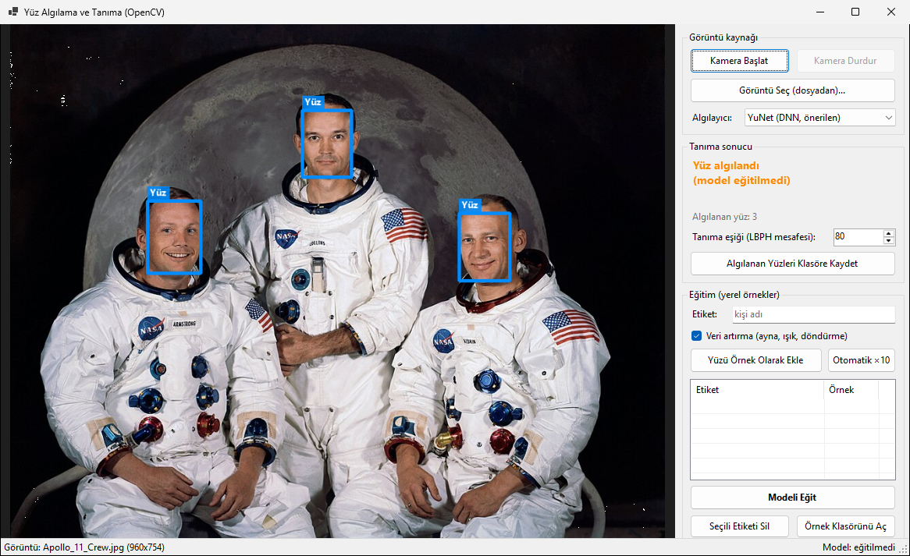
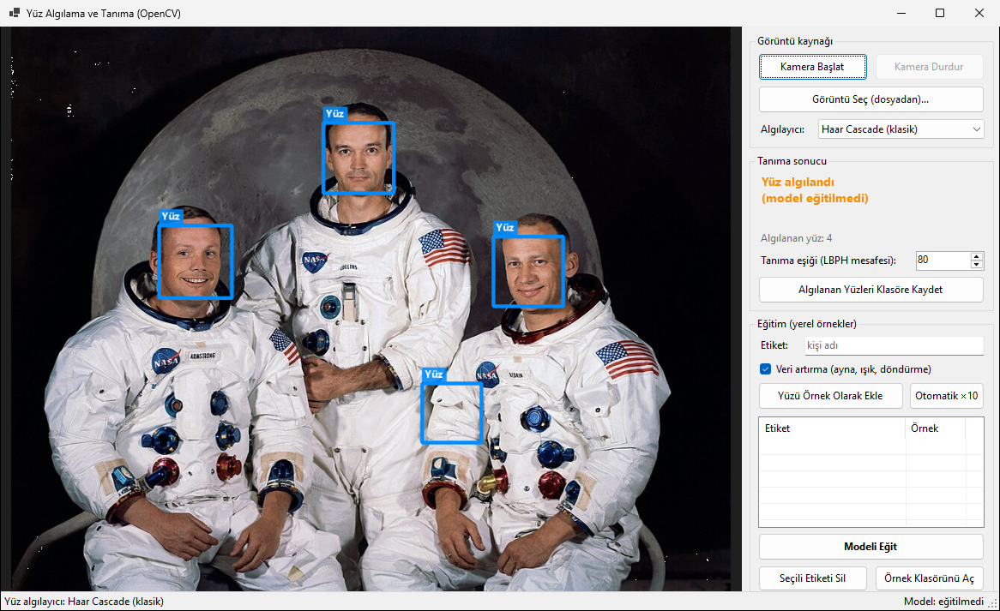

# YMH219-FaceRecognition — OpenCV ile Yüz Algılama ve Tanıma

OpenCvSharp4 kullanan bir Windows Forms uygulaması. Kameradan veya seçilen görüntü dosyasından alınan karede
yüzleri **YuNet (OpenCV DNN)** veya **Haar Cascade** ile algılar, dikdörtgenle işaretler ve kullanıcının oluşturduğu küçük yerel örnek kümesiyle
eğitilen **LBPH** modeliyle kişiyi etiketler. Tahmin edilen etiket ve güven skoru arayüzde gösterilir.
Nesne Tabanlı Programlama (YMH 219) dersi ek uygulama ödevidir.

| | |
|---|---|
| **Öğrenci** | Abdulkadir Demir |
| **Öğrenci numarası** | 240541007 |
| **Ders** | Nesne Tabanlı Programlama (YMH 219) |

## Ekran Görüntüleri

**Tanıma (eğitimde görülmemiş fotoğraf):** model yalnızca her kişinin tek bir portresiyle (Armstrong için iki) eğitildi.
Kalibrasyon önerilen eşiği **85** olarak ayarladı; Collins **%95** kalibre güvenle tanındı, Armstrong ve Aldrin bu fotoğrafta
eşiğin üstünde kaldığı için sistem yanlış isim vermek yerine **"Bilinmiyor"** dedi ve en yakın adayı bilgi olarak gösterdi.
Etiketler GDI+ ile çizildiği için Türkçe karakterler ("Bilinmiyor", "Yüz") doğru görünür.



| YuNet (DNN) — 3 yüz, sıkı kutular | Haar Cascade — eldiveni de yüz sanıyor (yanlış pozitif) |
|---|---|
|  |  |

Fotoğraflar: NASA, kamu malı (public domain); depoya eklenmemiştir.

## Kullanılan Teknolojiler / NuGet Paketleri

- C# 12, .NET 8 (`net8.0-windows`), Windows Forms
- **NuGet:**
  - `OpenCvSharp4` — OpenCV'nin .NET sarmalayıcısı (`Mat`, `FaceDetectorYN` (YuNet DNN), `CascadeClassifier`, `VideoCapture`, `CLAHE`, `OpenCvSharp.Face.LBPHFaceRecognizer`)
  - `OpenCvSharp4.runtime.win` — Windows için yerel OpenCV kütüphaneleri (contrib/face modülü dahil)
  - `OpenCvSharp4.Extensions` — `Mat` → `Bitmap` dönüşümü (PictureBox için)
- **Modeller:** `src/FaceRecognition/Models/`
  - `face_detection_yunet_2023mar.onnx` — YuNet DNN yüz algılayıcı (OpenCV Zoo)
  - `haarcascade_frontalface_default.xml` — OpenCV ile dağıtılan klasik Haar yüz algılayıcı

## Kurulum ve Çalıştırma

Gereksinim: Windows 10/11 (x64), [.NET 8 SDK](https://dotnet.microsoft.com/download/dotnet/8.0) veya Visual Studio 2022, isteğe bağlı web kamerası.

```powershell
git clone https://github.com/kdemirwarehouse/YMH219-FaceRecognition.git
cd YMH219-FaceRecognition
dotnet run --project src/FaceRecognition
```

Visual Studio ile: `FaceRecognition.sln` → başlangıç projesi `FaceRecognition` → **F5**. NuGet paketleri ilk derlemede otomatik indirilir.

**Testler:** `dotnet run --project tests/FaceRecognition.Tests` (13 test)

### Kullanım (en az iki etiketle tanıma)

1. **Kamera Başlat** veya **Görüntü Seç** — yüzler mavi dikdörtgenle işaretlenir (model henüz eğitilmedi).
2. **Etiket** kutusuna kişinin adını yazın (ör. `Ali`) → **Görüntüdeki Yüzü Örnek Olarak Ekle**.
   Kamerada başınızı hafifçe çevirip ışığı değiştirerek 5-10 kez tekrarlayın.
3. İkinci kişi (veya kendi yüzünüzün farklı bir görünümü, ör. `Ali-gozluklu`) için aynı işlemi yapın.
4. **Modeli Eğit** → artık yüzler yeşil (tanındı) veya kırmızı (bilinmiyor) çerçeveyle, etiket ve güven skoruyla gösterilir.

Örnekler `%LOCALAPPDATA%\YMH219-FaceRecognition\ornekler\<etiket>\` klasörlerinde saklanır, uygulama açılışında
model otomatik yeniden eğitilir. Örnek yüzler kişisel veri olduğu için **depoya yüklenmez** (`.gitignore`).

## Temel Özellikler

- **Kamera Başlat / Durdur** (arka plan görevinde kare okuma, arayüz donmaz) ve **Görüntü Seç** (jpg/png/bmp)
- **İki yüz algılayıcı:** varsayılan **YuNet** (OpenCV DNN, `FaceDetectorYN`, 232 KB ONNX modeli) eğik, yarı profil,
  kısmen gölgeli yüzlerde ve karmaşık arka planlarda Haar'dan belirgin şekilde başarılıdır, ayrıca göz/burun/ağız noktalarını
  verir; klasik **Haar Cascade** da seçilebilir. YuNet modeli yüklenemezse uygulama otomatik olarak Haar'a geçer.
  **Aynı karede birden fazla yüz** işaretlenir
- LBPH ile tanıma: tahmin edilen **etiket**, **güven skoru** ve LBPH **mesafesi** gösterilir
- Görüntü üzerindeki etiketler **GDI+ (Segoe UI)** ile çizilir; OpenCV'nin ASCII yazı tipinin aksine Türkçe karakterler
  korunur ("Ayşe", "Çağrı", "Gülşen")
- **Kalibre güven skoru ve otomatik eşik:** model eğitilirken örnekler üzerinde 5 katlı çapraz doğrulama yapılır;
  her kişi için *gerçek* (kendi diğer örneklerine) ve *sahte* (en yakın başka kişiye) LBPH mesafeleri ölçülür. Yanlış kabul +
  yanlış ret oranını en aza indiren mesafe **önerilen eşik** olarak otomatik ayarlanır, güven yüzdesi de bu eşik etrafında
  lojistik eğriyle hesaplanır (eşikte %50; eğri gerçek ve sahte dağılımların medyanları arasında ~%95'ten ~%5'e iner). Durum çubuğunda ölçülen FAR/FRR görünür.
  (En az 2 kişi ve kişi başı 5+ örnek gerekir; yoksa eski `100 − mesafe` ölçeği kullanılır.)
- Ayarlanabilir **tanıma eşiği**: mesafe eşikten büyükse "Bilinmiyor" (ve en yakın etiket bilgi olarak)
- **Basit eğitim / veri ekleme ekranı**: etiket yazıp örnek ekleme, etiket listesi ve örnek sayıları, etiket silme, örnek klasörünü açma
- **Yüz hizalama (YuNet göz noktalarıyla):** her yüz, iki göz yatay olacak şekilde döndürülür, gözler arası mesafe
  sabitlenir ve gözler 100x100 görüntüde hep aynı noktaya (%30/%70 genişlik, %36 yükseklik) gelir; eğik baş pozlarında
  LBPH mesafesi belirgin şekilde düşer
- **CLAHE** (yerel kontrast eşitleme): global histogram eşitlemeye göre yandan gelen ışıkta daha kararlı
- **Otomatik örnek toplama (Otomatik ×10):** kamera açıkken 0,4 sn arayla 10 örnek alınır (karede tam bir yüz varken),
  bittiğinde model kendiliğinden yeniden eğitilir — kullanıcı bu sırada başını hafifçe çevirerek farklı görünümler verir.
  *Not: Bu sürümden önce eklenen örnekler hizalanmadan kaydedildiği için silinip yeniden eklenmeleri önerilir.*
- **Veri artırma**: her örnekten ayna, aydınlık/karanlık ve ±8° döndürülmüş kopyalar üretilir (1 örnek → 6 görüntü)
- **Algılanan yüzleri ayrı klasöre kaydetme** (`...\YMH219-FaceRecognition\algilanan\`)
- **Hata yönetimi**: kamera yok / meşgul / izin kapalı, model dosyası eksik veya bozuk, OpenCV yerel kütüphanesi yüklenemedi,
  görüntü açılamadı, eğitim için yetersiz etiket — hepsi kullanıcıya mesajla bildirilir, uygulama kapanmaz

## Proje Yapısı

```
YMH219-FaceRecognition/
├── FaceRecognition.sln
├── src/
│   ├── FaceRecognition.Core/        OpenCV'den bağımsız, test edilebilir mantık
│   │   ├── EtiketKurallari.cs       Etiket (kişi adı) doğrulama
│   │   ├── TanimaKarari.cs          Mesafe + eşik → etiket / Bilinmiyor, güven yüzdesi
│   │   ├── MesafeKalibrasyonu.cs    Gerçek/sahte mesafe dağılımından eşik ve lojistik güven
│   │   ├── YuzHizalama.cs           Göz noktalarından döndürme/ölçek/öteleme geometrisi
│   │   └── OrnekDeposu.cs           ornekler/<etiket>/001.png klasör yönetimi, etiket Id'leri
│   └── FaceRecognition/
│       ├── Services/GoruntuServisi.cs  YuNet / Haar algılama, yüz hazırlama, veri artırma, LBPH eğitim/tahmin, çizim
│       ├── Services/KameraServisi.cs   VideoCapture ile arka planda kare okuma
│       ├── Models/face_detection_yunet_2023mar.onnx  YuNet DNN algılayıcı
│       ├── Models/haarcascade_frontalface_default.xml
│       ├── MainForm.cs / MainForm.Designer.cs
│       └── Program.cs               --ornekler / --resim parametreleri
├── tests/FaceRecognition.Tests/
└── docs/screenshots/
```

Ayrıntılı açıklama: [KOD-REHBERI.md](KOD-REHBERI.md)

## Kapsam ve Güvenlik Sınırı

Bu çalışma yalnızca ders kapsamında, **yerel ve gönüllü örneklerle** kullanılmak içindir. Görüntüler ve örnekler
yalnızca yerel diskte tutulur; ağ üzerinden hiçbir veri gönderilmez. Kamuya açık alanlarda izinsiz kimlik takibi,
gizli görüntü toplama veya kişileri uzaktan izleme amacıyla kullanılmamalıdır.

## Bilinen Sınırlamalar / Geliştirme Notları

- LBPH, derin öğrenme tabanlı yüz tanıyıcılar kadar güçlü değildir: hizalama ve otomatik örnek toplamaya rağmen aynı
  kişinin yıllar arayla çekilmiş, çok farklı ışık/renk koşulundaki fotoğraflarında mesafe büyüyebilir. Eşik düşük
  tutulduğu için sistem emin olmadığında yanlış isim vermek yerine "Bilinmiyor" der.

## Üçüncü Taraf Bileşenler

- OpenCV ve OpenCvSharp — Apache 2.0 lisansı
- `haarcascade_frontalface_default.xml` — Intel License Agreement (dosya başlığında), OpenCV deposundan
- `face_detection_yunet_2023mar.onnx` — MIT lisansı (Shiqi Yu), [OpenCV Zoo](https://github.com/opencv/opencv_zoo/tree/main/models/face_detection_yunet)
- Ekran görüntülerindeki fotoğraflar — NASA, kamu malı (public domain); depoya eklenmemiştir
