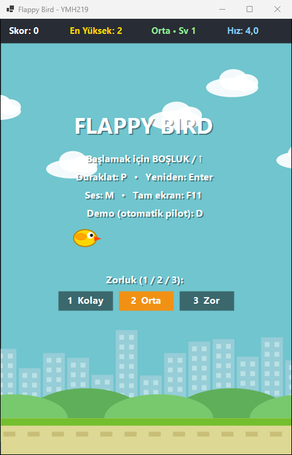
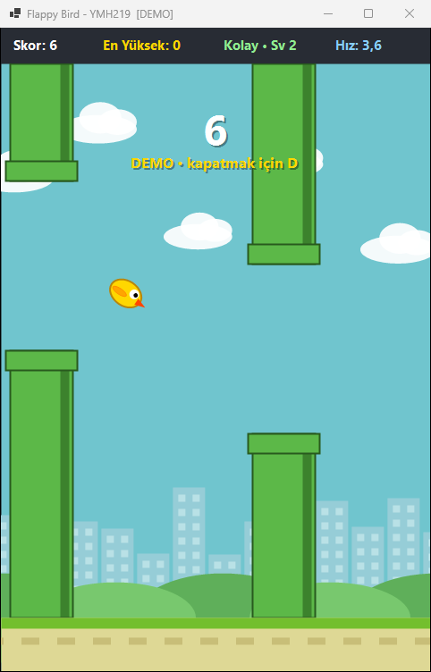
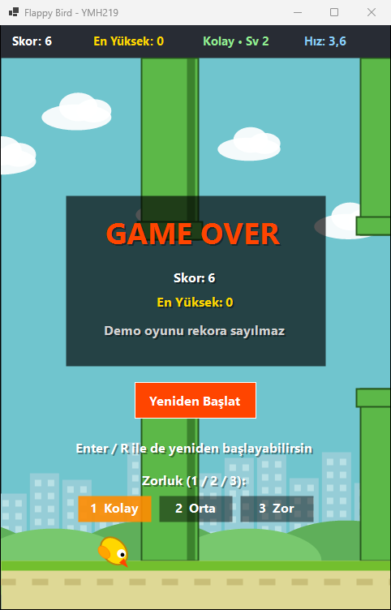
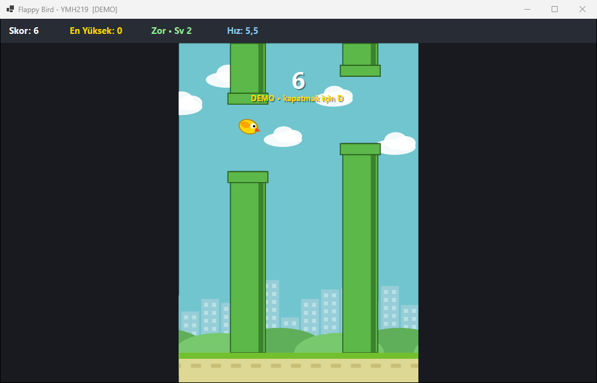

# YMH219-FlappyBird

Windows Forms ile geliştirilmiş, Flappy Bird benzeri bir masaüstü oyunu.
YMH219 dersi kapsamında; zamanlayıcı (Timer), klavye olayları, çarpışma kontrolü
ve oyun durumunun nesne tabanlı bir yapıyla yönetilmesini göstermek amacıyla hazırlanmıştır.

| | |
|---|---|
| **Öğrenci** | Abdulkadir Demir |
| **Öğrenci numarası** | 240541007 |
| **Ders** | Nesne Tabanlı Programlama (YMH 219) |

### ▶ Tarayıcıda oyna: **https://kdemirwarehouse.github.io/YMH219-FlappyBird/**

Windows Forms sürümünün aynı kurallarla çalışan JavaScript/Canvas portu (`web/index.html`) GitHub Actions ile
GitHub Pages'e yayınlanır. Mobilde dokunarak oynanabilir; demo için: [`?demo=1`](https://kdemirwarehouse.github.io/YMH219-FlappyBird/?demo=1).

## Ekran Görüntüleri

| Başlangıç — zorluk seçimi | Oyun sırasında (demo modu) | Game Over |
|---|---|---|
|  |  |  |

**Yeniden boyutlandırılmış pencere** — oyun alanı en-boy oranı korunarak ölçeklenir (Zor seviye, paralaks arka plan):



## Projenin Amacı

- Görsel bileşenleri çalışma zamanında hareket ettirmek
- Timer ile bir oyun döngüsü kurmak
- Klavye olaylarıyla (KeyDown / KeyUp) oyuncuyu kontrol etmek
- Çarpışma kontrolü yapmak ve oyun durumunu (Hazır, Oynanıyor, Duraklatıldı, Game Over) sınıflarla yönetmek

## Özellikler

- Kuş klavye ile yukarı zıplar, yer çekimiyle aşağı iner
- Üç boru çifti sağdan sola akar; ekran dışına çıkan boru rastgele bir yükseklikle sağda yeniden konumlanır
- Boruya, zemine çarpınca oyun durur ve **Game Over** ekranı gösterilir
- **Hassas çarpışma:** kuşun gövdesi elips olarak modellenir, boruların geniş ağız kısımları da hesaba katılır
  (önce hızlı dikdörtgen ön kontrolü, ardından elips–dikdörtgen testi)
- Her geçilen boru skoru 1 artırır
- **Yeniden Başlat** butonu (ayrıca Enter / R tuşu)
- Üst bilgi çubuğunda skor, en yüksek skor, seviye ve hız
- **İsteğe bağlı geliştirmeler:**
  - En yüksek skor **her zorluk için ayrı** dosyada saklanır (`%LOCALAPPDATA%\YMH219-FlappyBird\highscore.txt`, `Zorluk=Skor` satırları)
  - **Zorluk seçimi** (Hazır / Game Over ekranında 1-2-3): Kolay (geniş boşluk, yavaş), Orta, Zor (dar boşluk, hızlı, sık boru)
  - Her 5 puanda seviye atlanır ve oyun hızlanır
  - Oyun duraklatılabilir (P / Esc)
  - **Demo modu (D):** otomatik pilot her karede zıplama/zıplamama seçeneklerini ~0,6 sn ileriye simüle ederek
    (derinlik öncelikli arama) çarpışmasız yolu seçer;
    demo açılan oyunların skoru rekor olarak kaydedilmez
  - **Animasyonlar:** kanat çırpma (yükselirken hızlı, düşerken yavaş), Hazır ekranında süzülme ve
    üç katmanlı **paralaks arka plan** (bulutlar, şehir silüeti, tepeler farklı hızlarda kayar)
  - **Yeniden boyutlandırılabilir pencere ve tam ekran (F11):** oyun 480×680 mantıksal çözünürlükte hesaplanır,
    `Graphics.ScaleTransform` ile en-boy oranı korunarak pencereye sığdırılır (kenarlarda koyu şerit)
  - **Ses efektleri** (zıplama, puan, çarpma): harici dosya yoktur, tonlar açılışta bellekte WAV olarak üretilir; **M** ile sessiz mod

## Kontroller

| Tuş | İşlev |
|---|---|
| Boşluk / ↑ / W | Zıpla (Hazır ekranında oyunu başlatır) |
| P / Esc | Duraklat / Devam et |
| Enter / R | Game Over sonrası yeniden başlat |
| 1 / 2 / 3 | Zorluk: Kolay / Orta / Zor (Hazır veya Game Over ekranında) |
| D | Demo modu (otomatik pilot) aç / kapat |
| M | Sesi aç / kapat |
| F11 | Tam ekran / pencere |

## Kullanılan Teknolojiler

- C# 12
- .NET 8 (`net8.0-windows`)
- Windows Forms
- `System.Windows.Forms.Timer` + `Stopwatch` ile **sabit adımlı oyun döngüsü** (fixed timestep, saniyede 60 mantık adımı;
  Timer gecikse bile oyun hızı değişmez)
- GDI+ (`Graphics`) ile çizim, çift tamponlama (double buffering)

## Sınıf Yapısı

```
FlappyBird/
├── Program.cs            Uygulamanın giriş noktası
├── GameForm.cs           Form: Timer, klavye olayları, çizim, arayüz güncelleme
├── GameForm.Designer.cs  Form kontrolleri (Label, Button, Panel, Timer)
├── GamePanel.cs          Titremesiz çizim için çift tamponlu panel
└── Game/
    ├── GameManager.cs    Oyun kuralları: skor, seviye, hız, çarpışma, durum geçişleri
    ├── Bird.cs           Kuş: konum, hız, yer çekimi, zıplama
    ├── Pipe.cs           Boru çifti: hareket, yeniden konumlanma, çarpışma
    ├── Background.cs     Paralaks arka plan katmanları (bulut, şehir, tepe)
    ├── AutoPilot.cs      Demo modu: ileriyi simüle eden arama tabanlı otomatik pilot
    ├── GameState.cs      Oyun durumları (enum)
    ├── Difficulty.cs     Zorluk seviyeleri: boşluk, hız, boru aralığı
    ├── SoundEffects.cs   Bellekte WAV üretimi ve ses efektleri (SoundPlayer)
    └── HighScoreStore.cs En yüksek skoru dosyaya yazma / okuma
tests/
└── FlappyBird.Tests/     Konsol tabanlı birim testleri
web/
└── index.html            Tarayıcı sürümü (Canvas + Web Audio), GitHub Pages'e yayınlanır
.github/workflows/
└── pages.yml             web/ klasörünü GitHub Pages'e deploy eden iş akışı
```

- **Form ile oyun mantığı ayrıdır.** `GameForm` yalnızca olayları alır ve çizer; kuralların hepsi `GameManager` içindedir.
- `GameManager`, skor ya da durum değiştiğinde `StatusChanged` olayını tetikler; form bu olayla etiketleri günceller.
- Oyun döngüsü: `Timer.Tick` → geçen gerçek süre kadar sabit 1/60 sn'lik `GameManager.Update()` adımı → `Panel.Invalidate()` → `Paint` olayında çizim.

## Çalıştırma Adımları

### Visual Studio ile
1. Repoyu klonlayın:
   ```bash
   git clone https://github.com/kdemirwarehouse/YMH219-FlappyBird.git
   ```
2. `YMH219-FlappyBird.sln` dosyasını Visual Studio 2022 ile açın.
3. **F5** ile çalıştırın.

### Komut satırı ile
```bash
cd YMH219-FlappyBird
dotnet run --project FlappyBird
```

### Testler
```bash
dotnet run --project tests/FlappyBird.Tests
```
Harici test çatısı gerektirmeyen konsol test çalıştırıcısı; fizik, durum geçişleri, elips çarpışma,
boru yerleşimi, skor dosyası ses üretimi, zorluk seviyeleri ve demo modu için 15 test içerir.

**Gereksinim:** Windows ve [.NET 8 SDK](https://dotnet.microsoft.com/download/dotnet/8.0).

## Bilinen Sınırlamalar / Geliştirme Notları

- Masaüstü sürümünde `SoundPlayer` aynı anda tek ses çalar; peş peşe gelen efektte yeni ses öncekini keser
  (web sürümünde Web Audio API kullanıldığı için sesler üst üste çalabilir).
- Web sürümünde rekorlar tarayıcının `localStorage` alanında tutulur; masaüstü rekorlarıyla ortak değildir.

