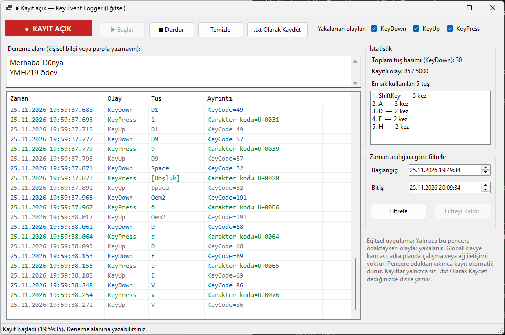
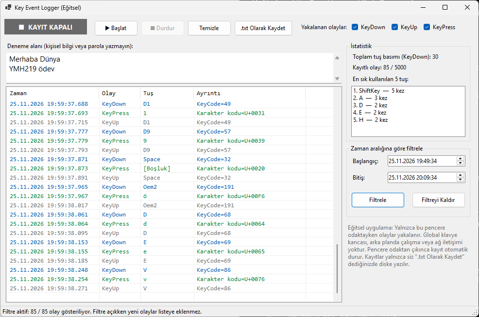

# YMH219-KeyEventLogger — Key Event Logger (Eğitsel)

Windows Forms'ta klavye olaylarının (**KeyDown, KeyUp, KeyPress**) nasıl yakalandığını ve uygulama
içinde nasıl işlendiğini gösteren eğitsel bir uygulama. Yalnızca **kendi penceresi odaktayken**
basılan tuşları zaman bilgisiyle listeler ve kullanıcı isterse `.txt` dosyasına kaydeder.
Nesne Tabanlı Programlama (YMH 219) dersi ek uygulama ödevidir.

| | |
|---|---|
| **Öğrenci** | Abdulkadir Demir |
| **Öğrenci numarası** | 240541007 |
| **Ders** | Nesne Tabanlı Programlama (YMH 219) |

## Ekran Görüntüleri

| Kayıt açık — olaylar canlı listeleniyor | Kayıt durduruldu — zaman filtresi aktif |
|---|---|
|  |  |

## Kapsam ve Güvenlik Sınırı

Bu uygulama gerçek bir sistem keylogger'ı **değildir**:

- Olaylar yalnızca formun kendi `KeyDown` / `KeyUp` / `KeyPress` olaylarından (`KeyPreview = true`) alınır.
- **Global klavye hook'u yok**, gizli / arka plan çalışma yok, başlangıçta otomatik çalışma yok, ağ iletişimi yok.
- Pencere odağı kaybedilince (`Deactivate`) kayıt **otomatik durur**; devam etmek için tekrar *Başlat*'a basılmalıdır.
- Odaktaki kontrol bir parola alanıysa (`PasswordChar` / `UseSystemPasswordChar`) olay kaydedilmez.
- Kayıtlar diske kendiliğinden yazılmaz; yalnızca kullanıcı *.txt Olarak Kaydet* ile dosya seçerse yazılır.
  Varsayılan dosya adı (`klavye-olaylari-*.txt`) `.gitignore` ile depodan dışlanmıştır.

## Kullanılan Teknolojiler

- C# 12, .NET 8 (`net8.0-windows`), Windows Forms
- `KeyPreview`, `KeyDown`, `KeyUp`, `KeyPress`, `Deactivate` olayları
- `StreamWriter` (UTF-8) ile dosya yazımı, `DateTime` ile milisaniyeli zaman damgası
- LINQ (`GroupBy`, `OrderByDescending`) ile istatistik
- **Harici NuGet paketi yoktur.**

## Kurulum ve Çalıştırma

Gereksinim: Windows 10/11 ve [.NET 8 SDK](https://dotnet.microsoft.com/download/dotnet/8.0)
(veya .NET masaüstü geliştirme iş yükü kurulu Visual Studio 2022).

**Visual Studio ile:** `KeyEventLogger.sln` dosyasını açın, `KeyEventLogger` başlangıç projesiyle **F5**.

**Komut satırı ile**

```powershell
git clone https://github.com/kdemirwarehouse/YMH219-KeyEventLogger.git
cd YMH219-KeyEventLogger
dotnet run --project src/KeyEventLogger
```

**Testler:** `dotnet run --project tests/KeyEventLogger.Tests` (10 test)

## Temel Özellikler

1. **Başlat / Durdur** — kayıt durumunu kontrol eder. Üstteki gösterge kayıt açıkken kırmızı
   **● KAYIT AÇIK**, kapalıyken gri **■ KAYIT KAPALI** olur; pencere başlığı da durumu gösterir.
2. **Olay listesi** — her olay için tarih-saat (milisaniye dahil), olay türü, tuş adı ve ayrıntı
   (KeyCode, değiştirici tuşlar, karakter kodu). Olay türleri renklerle ayrılır.
3. **Temizle** — ekrandaki kayıtları siler; kayıt durumu değişmez.
4. **.txt Olarak Kaydet** — kaydı durdurur, `SaveFileDialog` ile seçilen dosyaya UTF-8 olarak yazar.
   Yazma hatasında kayıtlar bellekte korunur ve kullanıcıya mesaj gösterilir.
5. **Olay türü seçimi** — KeyDown / KeyUp / KeyPress onay kutularıyla ayrı ayrı açılıp kapatılabilir.
6. **İsteğe bağlı geliştirmeler**
   - **İstatistik:** toplam tuş basımı (KeyDown sayısı), kayıtlı olay sayısı ve en sık kullanılan 5 tuş
   - **Tarih/saat aralığına göre filtreleme**; filtre aktifken kaydetme yalnızca filtrelenmiş olayları yazar
7. Bellek koruması: 5000 olayda kayıt otomatik durur.

## Proje Yapısı

```
YMH219-KeyEventLogger/
├── KeyEventLogger.sln
├── src/
│   ├── KeyEventLogger.Core/        Arayüzden bağımsız mantık
│   │   ├── KeyLogEntry.cs          Olay kaydı (record) + OlayTuru enum
│   │   ├── KayitOturumu.cs         Başlat/Durdur/Temizle, sınır, istatistik, filtre
│   │   └── KayitDosyasi.cs         .txt dosyasına yazma (StreamWriter)
│   └── KeyEventLogger/             Windows Forms
│       ├── MainForm.cs             Klavye olayları, butonlar, gösterge
│       └── MainForm.Designer.cs
├── tests/KeyEventLogger.Tests/     Konsol test çalıştırıcısı
└── docs/screenshots/
```

Ayrıntılı açıklama: [KOD-REHBERI.md](KOD-REHBERI.md)

## Bilinen Sınırlamalar / Geliştirme Notları

- Ok tuşları, Tab gibi gezinme tuşları odaktaki butona gidebilir ve Windows tarafından işlendiği için
  her durumda `KeyDown` olayı üretmeyebilir (en iyi sonuç deneme alanı odaktayken alınır).
- `KeyPress` yalnızca karakter üreten tuşlarda oluşur; Shift, Ctrl, F1 gibi tuşlar için yalnızca KeyDown/KeyUp gelir.
- Tuşa basılı tutulduğunda Windows tekrar eden KeyDown/KeyPress olayları üretir; bunlar ayrı olay olarak listelenir.
- Kayıtlar yalnızca bellekte tutulur; uygulama kapatılınca kaydedilmemiş olaylar kaybolur.
