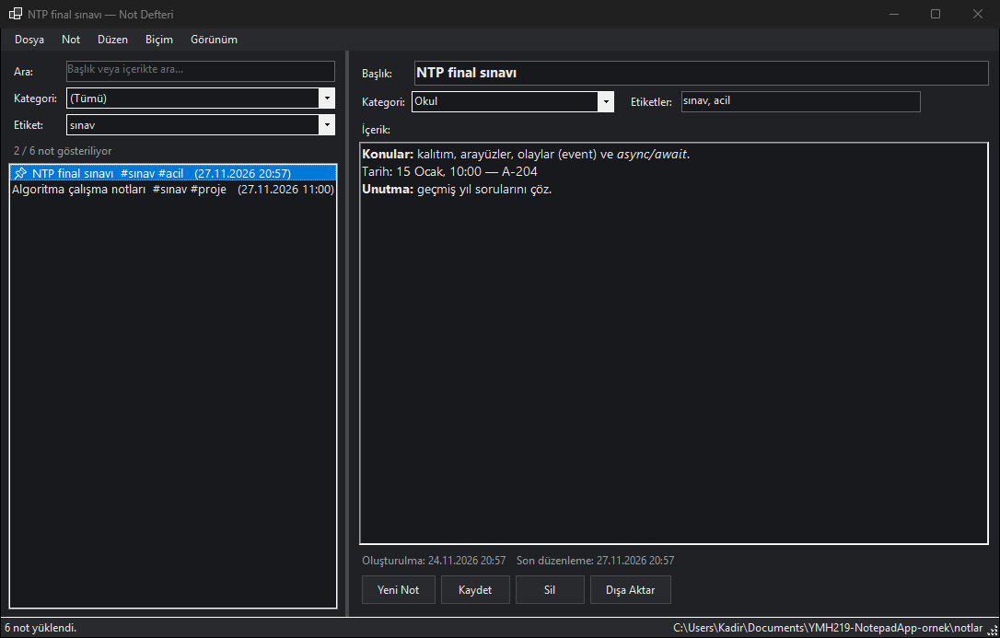

# YMH219-NotepadApp — Not Defteri (Dosya İşlemleri + Serileştirme)

Notları bilgisayarda kalıcı olarak saklayan bir Windows Forms not defteri uygulaması.
Notlar `List<Not>` koleksiyonunda tutulur, **JSON** biçiminde dosyaya serileştirilir ve uygulama
her açıldığında otomatik olarak geri yüklenir. Nesne Tabanlı Programlama (YMH 219) dersi ek uygulama ödevidir.

| | |
|---|---|
| **Öğrenci** | Abdulkadir Demir |
| **Öğrenci numarası** | 240541007 |
| **Ders** | Nesne Tabanlı Programlama (YMH 219) |

## Ekran Görüntüleri

| Açık tema — 📌 sabit notlar, `#etiket`ler, biçimli içerik | Karanlık tema — "sınav" etiket filtresi |
|---|---|
|  |  |

Durum çubuğundaki "6 not yüklendi." mesajı notların not klasöründen (her not ayrı `.json` dosyası) geri yüklendiğini gösterir.
Sağ alttaki yol, `--veri` parametresiyle verilen not klasörüdür.

## Kullanılan Teknolojiler

- C# 12, .NET 8 (`net8.0-windows`), Windows Forms
- `System.IO` — `StreamReader`, `StreamWriter`, `File`, `Directory`, `Path`
- `System.Text.Json` — `JsonSerializer` ile serileştirme (.NET'in içinde gelir)
- **Harici NuGet paketi yoktur.**

## Kurulum ve Çalıştırma

Gereksinim: Windows 10/11 ve [.NET 8 SDK](https://dotnet.microsoft.com/download/dotnet/8.0)
(veya .NET masaüstü geliştirme iş yükü kurulu Visual Studio 2022).

**Visual Studio ile**

1. `git clone https://github.com/kdemirwarehouse/YMH219-NotepadApp.git`
2. `NotepadApp.sln` dosyasını açın.
3. Başlangıç projesi olarak `NotepadApp` seçili olmalı; **F5** ile çalıştırın.

**Komut satırı ile**

```powershell
cd YMH219-NotepadApp
dotnet run --project src/NotepadApp
```

**Testleri çalıştırma**

```powershell
dotnet run --project tests/NotepadApp.Tests
```

Notlar varsayılan olarak `%APPDATA%\YMH219-NotepadApp\notlar\` klasöründe, **her not ayrı bir `<Id>.json` dosyasında** saklanır.
Farklı bir dosya ile denemek için: `dotnet run --project src/NotepadApp -- --veri C:\deneme\notlar.json`

## Temel Özellikler

- **Not ekleme / listeleme / düzenleme / silme** — başlık, kategori ve içerikten oluşan notlar
- **Oluşturma ve son düzenleme tarihi** her not için tutulur ve düzenleyicide gösterilir
- **JSON serileştirme** ile kaydetme; uygulama açılışında **otomatik geri yükleme**
- **Artımlı (incremental) kayıt:** her not ayrı dosyadadır; kaydetmede yalnızca içeriği değişen notların dosyası yeniden
  yazılır, silinen notun dosyası kaldırılır (durum çubuğunda "x dosya yazıldı, y silindi"). Yazma, geçici dosya + taşıma ile
  atomiktir. Eski sürümün tek dosyalı `notlar.json`'ı ilk açılışta klasöre taşınır ve `notlar.json.eski` olarak saklanır.
- **Çoklu pencere güvenliği (iyimser eşzamanlılık):** her notun bir `Surum` numarası vardır. Uygulama iki pencerede
  açıksa ve aynı not ikisinde de değiştirilirse, ikinci kaydeden **çakışma** penceresi görür: *benim sürümüm*,
  *diskteki sürüm* veya *ikisini de tut (kopya)*. Başka pencerenin eklediği notlar asla silinmez. Not klasörü
  `FileSystemWatcher` ile izlenir; bu pencerede kaydedilmemiş değişiklik yoksa diğer pencerenin kaydettikleri otomatik yüklenir.
- **Dışa aktarma** — seçili not üç biçimde kaydedilebilir:
  - **.rtf** — kalın/italik/altı çizili biçimlendirme korunur (Word, WordPad)
  - **.html** — biçimlendirme `<b>`, `<i>`, `<u>` etiketlerine çevrilir (küçük bir RTF ayrıştırıcısıyla; Türkçe karakterler korunur)
  - **.txt** — başlık, kategori ve tarihlerle birlikte düz metin
- **Hata yönetimi**
  - Dosya yoksa boş liste ile başlanır (ilk açılış)
  - Bir not dosyası bozuksa (geçersiz JSON) yalnızca o dosya `.bak` olarak yedeklenir, diğer notlar yüklenir ve kullanıcı uyarılır
  - Okuma/yazma izni hatalarında uygulama kapanmaz, kullanıcıya mesaj gösterilir
  - Kaydetme önce `.tmp` dosyasına yapılır, sonra asıl dosyanın yerine taşınır; yazma yarıda kesilirse eski notlar bozulmaz
- **Kaydedilmemiş değişiklik uyarısı** — başka nota geçerken, yeni not açarken ve çıkışta sorulur;
  pencere başlığındaki `*` kaydedilmemiş değişikliği gösterir
- **İsteğe bağlı geliştirmeler**
  - Başlığa veya içeriğe göre anlık **arama**
  - **Kategori** desteği ve kategoriye göre filtreleme
  - Her işlemden sonra **otomatik kaydetme** (Not menüsünden kapatılabilir)
  - RichTextBox ile **kalın / italik** biçimlendirme (Ctrl+B, Ctrl+I); biçim RTF olarak saklanır
  - **Etiketler (çoklu kategori):** her notun tek kategorisine ek olarak en fazla 10 etiketi olabilir
    (`sınav, proje, acil` — virgül, noktalı virgül veya # ile ayrılır). Listede `#etiket` olarak görünür, filtre panelindeki
    **Etiket** kutusuyla süzülür ve aramada da (`#proj`) eşleşir. Kategori ve etiket filtreleri birlikte kullanılabilir.
  - **XML serileştirme (JSON'a alternatif):** Dosya menüsünden tüm notlar `XmlSerializer` ile tek bir `.xml` arşivine
    (`<NotArsivi><Not>...`) dışa aktarılır ve geri içe aktarılır. İçe aktarmada aynı Id'li notlardan son düzenlenen kazanır;
    yeni / güncellenen / atlanan not sayıları gösterilir. Yedekleme ve başka bilgisayara taşıma için kullanılabilir.
  - **Karanlık tema** (Görünüm menüsü, Ctrl+Shift+D): tüm kontroller, menüler (özel `ProfessionalColorTable`) ve
    Windows 10/11 başlık çubuğu (`DwmSetWindowAttribute`, koyu mod) koyulaşır. Tema ve otomatik kaydetme tercihi
    `%APPDATA%\YMH219-NotepadApp\ayarlar.json` dosyasında saklanır, sonraki açılışta hatırlanır.
  - **Not sabitleme** (Not menüsü, Ctrl+P): sabitlenen notlar 📌 ile listenin en üstünde kalır; sabitleme JSON'da saklanır
  - **Çok seviyeli geri al / yinele** (Düzen menüsü, Ctrl+Z / Ctrl+Y): düzenleyicinin RTF + imleç durumu, yazma
    0,6 sn durduğunda bir adım olarak kaydedilir; kalın/italik değişiklikleri ayrı adımdır. 200 adım tutulur, menüde
    kalan adım sayısı görünür. Başka bir not açıldığında geçmiş o not için sıfırlanır.

### Klavye kısayolları

| Kısayol | İşlev |
|---|---|
| Ctrl+N | Yeni not |
| Ctrl+S | Notu kaydet |
| Ctrl+Shift+D | Karanlık / açık tema |
| Ctrl+P | Seçili notu sabitle / sabitlemeyi kaldır |
| Ctrl+Z / Ctrl+Y | Geri al / yinele (200 adım, biçimlendirme dahil) |
| Ctrl+E | Seçili notu dışa aktar (.rtf / .html / .txt) |
| Ctrl+Delete | Seçili notu sil |
| F5 | Notları dosyadan yeniden yükle |
| Ctrl+B / Ctrl+I | Seçili metni kalın / italik yap |

## Proje Yapısı

```
YMH219-NotepadApp/
├── NotepadApp.sln
├── src/
│   ├── NotepadApp.Core/            Arayüzden bağımsız iş mantığı (sınıf kütüphanesi)
│   │   ├── Models/Not.cs           Not sınıfı: başlık, içerik, kategori, tarihler, doğrulama
│   │   └── Services/
│   │       ├── NotDefteri.cs       List<Not> yönetimi: ekle, güncelle, sil, ara, filtrele
│   │       ├── Ayarlar.cs          Tema / otomatik kaydetme tercihleri (ayarlar.json)
│   │       ├── XmlNotAktarici.cs   XmlSerializer ile tüm notları XML arşivine aktarma / içe alma
│   │       ├── GeriAlGecmisi.cs    Sınırlı kapasiteli genel geri al / yinele yığını
│   │       ├── BicimliDisaAktarici.cs  .rtf ve .html dışa aktarma (küçük RTF → HTML ayrıştırıcısı)
│   │       ├── NotDeposu.cs        Not başına JSON dosyası, artımlı kayıt, eski biçimden taşıma, bozuk dosya yönetimi
│   │       └── TxtDisaAktarici.cs  Notu .txt dosyasına yazma (StreamWriter)
│   └── NotepadApp/                 Windows Forms uygulaması
│       ├── Program.cs              Giriş noktası, --veri parametresi
│       ├── MainForm.cs             Olay yöneticileri ve kullanıcı etkileşimi
│       └── MainForm.Designer.cs    Form kontrolleri
├── tests/NotepadApp.Tests/         25 testlik konsol test çalıştırıcısı
└── docs/screenshots/               README ekran görüntüleri
```

Form yalnızca kullanıcı etkileşimini yönetir; not kuralları `NotDefteri`, dosya işlemleri `NotDeposu`
sınıfındadır. `NotDefteri` her değişiklikte `Degisti` olayını tetikler, form bu olayı dinleyerek otomatik kaydeder.
Ayrıntılı açıklama için [KOD-REHBERI.md](KOD-REHBERI.md) dosyasına bakın.

## Bilinen Sınırlamalar / Geliştirme Notları

- Çakışma algılama not düzeyindedir; aynı notun farklı paragraflarını iki pencerede değiştirmek de çakışma sayılır
  (otomatik birleştirme yapılmaz, kullanıcı hangi sürümün kalacağını seçer).
- Karanlık temada `ComboBox` açılır okları Windows'un standart çizimini kullanır.

