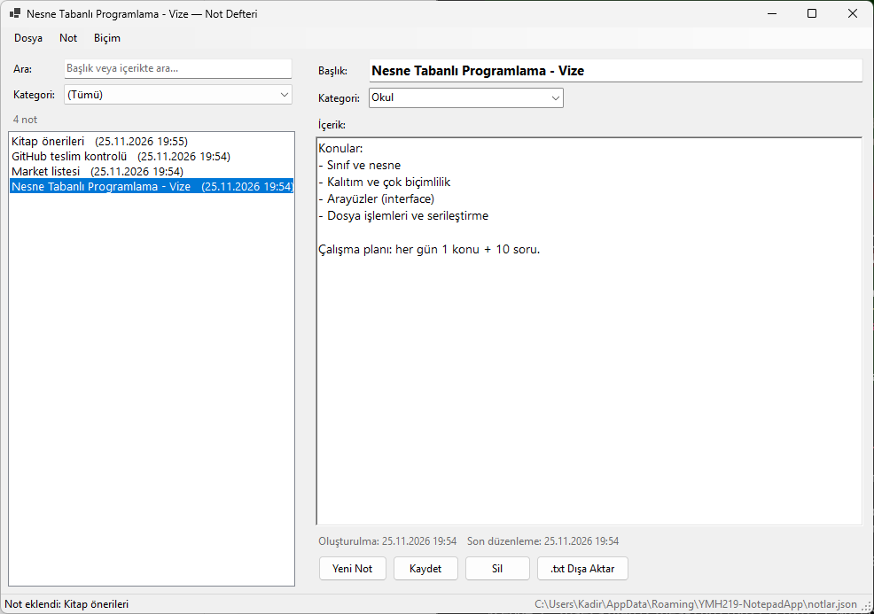
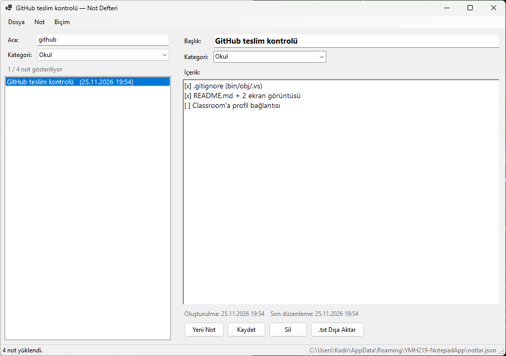

# YMH219-NotepadApp — Not Defteri (Dosya İşlemleri + Serileştirme)

Notları bilgisayarda kalıcı olarak saklayan bir Windows Forms not defteri uygulaması.
Notlar `List<Not>` koleksiyonunda tutulur, **JSON** biçiminde dosyaya serileştirilir ve uygulama
her açıldığında otomatik olarak geri yüklenir. Nesne Tabanlı Programlama (YMH 219) dersi ek uygulama ödevidir.

| | |
|---|---|
| **Öğrenci** | Abdulkadir Demir |
| **Öğrenci numarası** | 240541007 |
| **Ders** | Nesne Tabanlı Programlama (YMH 219) |

## Ekran Görüntüleri

| Not listesi ve düzenleyici | Yeniden açılış sonrası arama + kategori filtresi |
|---|---|
|  |  |

İkinci görüntü uygulama kapatılıp yeniden açıldıktan sonra alınmıştır; durum çubuğundaki
"4 not yüklendi." mesajı notların dosyadan geri yüklendiğini gösterir.

## Kullanılan Teknolojiler

- C# 12, .NET 8 (`net8.0-windows`), Windows Forms
- `System.IO` — `StreamReader`, `StreamWriter`, `File`, `Directory`, `Path`
- `System.Text.Json` — `JsonSerializer` ile serileştirme (.NET'in içinde gelir)
- **Harici NuGet paketi yoktur.**

## Kurulum ve Çalıştırma

Gereksinim: Windows 10/11 ve [.NET 8 SDK](https://dotnet.microsoft.com/download/dotnet/8.0)
(veya .NET masaüstü geliştirme iş yükü kurulu Visual Studio 2022).

**Visual Studio ile**

1. `git clone https://github.com/kdemirwarehouse/YMH219-NotepadApp.git`
2. `NotepadApp.sln` dosyasını açın.
3. Başlangıç projesi olarak `NotepadApp` seçili olmalı; **F5** ile çalıştırın.

**Komut satırı ile**

```powershell
cd YMH219-NotepadApp
dotnet run --project src/NotepadApp
```

**Testleri çalıştırma**

```powershell
dotnet run --project tests/NotepadApp.Tests
```

Notlar varsayılan olarak `%APPDATA%\YMH219-NotepadApp\notlar.json` dosyasında saklanır.
Farklı bir dosya ile denemek için: `dotnet run --project src/NotepadApp -- --veri C:\deneme\notlar.json`

## Temel Özellikler

- **Not ekleme / listeleme / düzenleme / silme** — başlık, kategori ve içerikten oluşan notlar
- **Oluşturma ve son düzenleme tarihi** her not için tutulur ve düzenleyicide gösterilir
- **JSON serileştirme** ile kaydetme; uygulama açılışında **otomatik geri yükleme**
- **.txt dışa aktarma** — seçili not; başlık, kategori ve tarihlerle birlikte düz metin olarak kaydedilir
- **Hata yönetimi**
  - Dosya yoksa boş liste ile başlanır (ilk açılış)
  - Dosya boş veya bozuksa (geçersiz JSON) bozuk dosyanın `.bak` yedeği alınır ve kullanıcı uyarılır
  - Okuma/yazma izni hatalarında uygulama kapanmaz, kullanıcıya mesaj gösterilir
  - Kaydetme önce `.tmp` dosyasına yapılır, sonra asıl dosyanın yerine taşınır; yazma yarıda kesilirse eski notlar bozulmaz
- **Kaydedilmemiş değişiklik uyarısı** — başka nota geçerken, yeni not açarken ve çıkışta sorulur;
  pencere başlığındaki `*` kaydedilmemiş değişikliği gösterir
- **İsteğe bağlı geliştirmeler**
  - Başlığa veya içeriğe göre anlık **arama**
  - **Kategori** desteği ve kategoriye göre filtreleme
  - Her işlemden sonra **otomatik kaydetme** (Not menüsünden kapatılabilir)
  - RichTextBox ile **kalın / italik** biçimlendirme (Ctrl+B, Ctrl+I); biçim RTF olarak saklanır

### Klavye kısayolları

| Kısayol | İşlev |
|---|---|
| Ctrl+N | Yeni not |
| Ctrl+S | Notu kaydet |
| Ctrl+E | Seçili notu .txt olarak dışa aktar |
| Ctrl+Delete | Seçili notu sil |
| F5 | Notları dosyadan yeniden yükle |
| Ctrl+B / Ctrl+I | Seçili metni kalın / italik yap |

## Proje Yapısı

```
YMH219-NotepadApp/
├── NotepadApp.sln
├── src/
│   ├── NotepadApp.Core/            Arayüzden bağımsız iş mantığı (sınıf kütüphanesi)
│   │   ├── Models/Not.cs           Not sınıfı: başlık, içerik, kategori, tarihler, doğrulama
│   │   └── Services/
│   │       ├── NotDefteri.cs       List<Not> yönetimi: ekle, güncelle, sil, ara, filtrele
│   │       ├── NotDeposu.cs        JSON kaydet / yükle, bozuk-eksik dosya yönetimi
│   │       └── TxtDisaAktarici.cs  Notu .txt dosyasına yazma (StreamWriter)
│   └── NotepadApp/                 Windows Forms uygulaması
│       ├── Program.cs              Giriş noktası, --veri parametresi
│       ├── MainForm.cs             Olay yöneticileri ve kullanıcı etkileşimi
│       └── MainForm.Designer.cs    Form kontrolleri
├── tests/NotepadApp.Tests/         12 testlik konsol test çalıştırıcısı
└── docs/screenshots/               README ekran görüntüleri
```

Form yalnızca kullanıcı etkileşimini yönetir; not kuralları `NotDefteri`, dosya işlemleri `NotDeposu`
sınıfındadır. `NotDefteri` her değişiklikte `Degisti` olayını tetikler, form bu olayı dinleyerek otomatik kaydeder.
Ayrıntılı açıklama için [KOD-REHBERI.md](KOD-REHBERI.md) dosyasına bakın.

## Bilinen Sınırlamalar / Geliştirme Notları

- Tüm notlar tek bir JSON dosyasında tutulur; çok büyük not sayılarında her kayıtta dosyanın tamamı yeniden yazılır.
- Aynı not dosyası iki ayrı uygulama penceresinden aynı anda düzenlenirse son kaydeden kazanır (kilit mekanizması yoktur).
- .txt dışa aktarmada kalın/italik biçimlendirme kaybolur, yalnızca düz metin yazılır.
- Geri al / yinele geçmişi yalnızca RichTextBox'ın kendi geri alma özelliğiyle sınırlıdır.
- Olası geliştirmeler: not sabitleme, etiket (çoklu kategori), XML'e alternatif serileştirme, karanlık tema.
