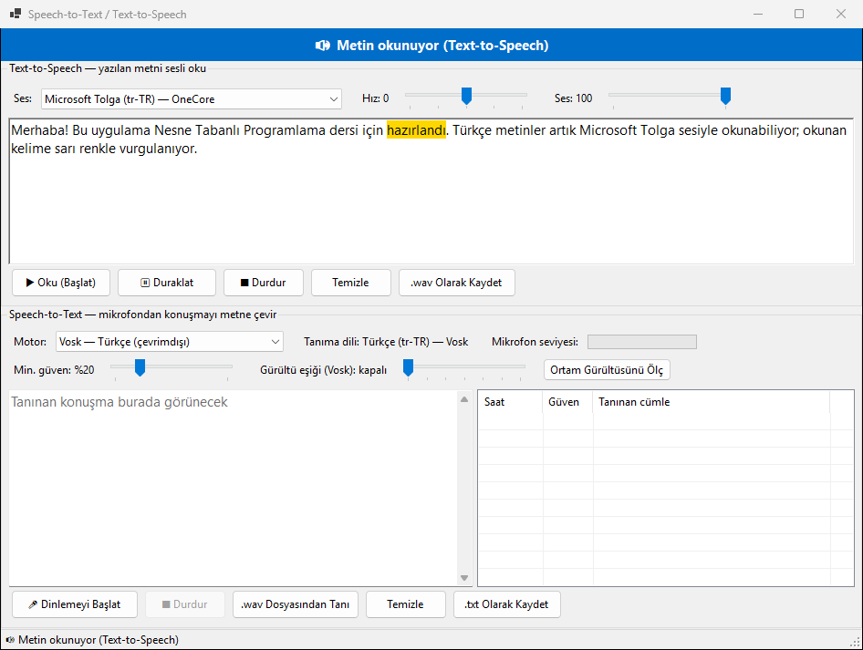
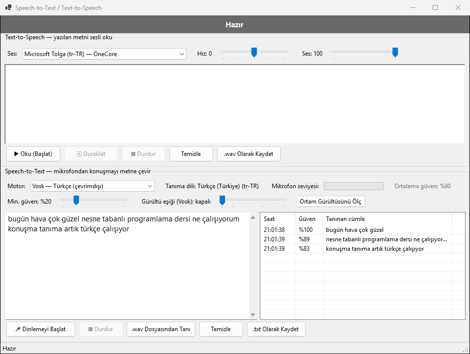

# YMH219-SpeechApp — Speech-to-Text ve Text-to-Speech

Ses ve metin arasında çift yönlü dönüşüm yapan Windows Forms uygulaması. Kullanıcı yazdığı metni
sesli okutabilir (TTS) ve mikrofondan alınan konuşmayı metne dönüştürebilir (STT).
Windows'un yerleşik konuşma altyapısı (SAPI) `System.Speech` kütüphanesi üzerinden kullanılır.
Nesne Tabanlı Programlama (YMH 219) dersi ek uygulama ödevidir.

| | |
|---|---|
| **Öğrenci** | Abdulkadir Demir |
| **Öğrenci numarası** | 240541007 |
| **Ders** | Nesne Tabanlı Programlama (YMH 219) |

### ▶ Tarayıcıda dene: **https://kdemirwarehouse.github.io/YMH219-SpeechApp/**

Web sürümü (`web/index.html`) Web Speech API ile **her işletim sisteminde** (Windows, macOS, Linux, Android) çalışır:
Türkçe dahil tarayıcının tüm sesleriyle okuma (okunan kelime vurgulanır, duraklat/devam), Chrome/Edge'de **Türkçe konuşma
tanıma** (ara sonuç, güven skoru, minimum güven filtresi, mikrofon seviyesi) ve .txt kaydı. GitHub Actions ile GitHub Pages'e yayınlanır.

## Ekran Görüntüleri

| Türkçe metin **Microsoft Tolga (OneCore)** ile okunuyor — okunan kelime sarı | **Vosk ile çevrimdışı Türkçe tanıma** — cümleler, saat ve güven skoru |
|---|---|
|  |  |

Üstteki renkli şerit o an hangi işlemin aktif olduğunu gösterir (gri: hazır, mavi: okunuyor,
turuncu: duraklatıldı, kırmızı: mikrofon dinleniyor, mor: ses dosyası tanınıyor).
Sağdaki tanıma sonuçları, Tolga sesiyle üretilen Türkçe bir .wav dosyasının `SpeechApp.exe --motor vosk --wav ornek.wav`
ile metne çevrilmesiyle elde edilmiştir (ortalama güven %90).

## Kullanılan Teknolojiler / NuGet Paketleri

- C# 12, .NET 8 (`net8.0-windows10.0.19041.0`), Windows Forms
- **NuGet:** [`System.Speech`](https://www.nuget.org/packages/System.Speech) 8.0.0
  - `SpeechSynthesizer` — metni sese çevirme, ses seçimi, hız, ses düzeyi, duraklat/devam
  - `SpeechRecognitionEngine` + `DictationGrammar` — serbest dikte ile konuşma tanıma
- **NuGet:** [`Vosk`](https://www.nuget.org/packages/Vosk) 0.3.38 (çevrimdışı tanıma), [`NAudio`](https://www.nuget.org/packages/NAudio) 2.2.1 (mikrofon, ses dönüştürme)
- **Windows OneCore (WinRT, ek paket gerekmez):** `Windows.Media.SpeechSynthesis.SpeechSynthesizer` (Türkçe Tolga dahil
  tüm Windows sesleri, kelime sınırı meta verisi), `Windows.Media.Playback.MediaPlayer` (duraklat/devam)
- `StreamWriter` ile .txt kaydı

## Kurulum ve Çalıştırma

Gereksinim: Windows 10/11, [.NET 8 SDK](https://dotnet.microsoft.com/download/dotnet/8.0) veya Visual Studio 2022,
konuşma tanıma için bir mikrofon.

```powershell
git clone https://github.com/kdemirwarehouse/YMH219-SpeechApp.git
cd YMH219-SpeechApp
dotnet run --project src/SpeechApp
```

Visual Studio ile: `SpeechApp.sln` → başlangıç projesi `SpeechApp` → **F5**.
NuGet paketi ilk derlemede otomatik indirilir.

**Testler:** `dotnet run --project tests/SpeechApp.Tests` (16 test)

**Mikrofon izni:** Windows Ayarlar → Gizlilik ve güvenlik → Mikrofon → *Masaüstü uygulamalarının mikrofona erişmesine izin ver* açık olmalıdır.

**Dil:** Uygulama kurulu tanıyıcılar arasından önce sistem dilini (ör. `tr-TR`), yoksa aynı dili, yoksa `en-US`'i seçer;
seçilen dil arayüzde gösterilir. Okuma sesleri de "Ses" listesinden seçilir.

## Temel Özellikler

**Text-to-Speech**
- Metin kutusundaki yazıyı **Oku (Başlat)**, **Duraklat / Devam**, **Durdur**, **Temizle**
- Okunan kelime anlık olarak **sarı** vurgulanır (`SpeakProgress` olayı)
- **Ses seçimi**, **hız** (-10…10) ve **ses düzeyi** (0…100) ayarı
- **İki okuma motoru:** klasik **SAPI** (`System.Speech`) ve Windows 10/11 **OneCore** (`Windows.Media.SpeechSynthesis`, WinRT).
  OneCore, Windows dil paketiyle gelen sesleri de görür — örneğin SAPI'de bulunmayan **Türkçe "Microsoft Tolga"** sesi.
  Uygulama açılışta kurulu bir Türkçe ses varsa onu (yoksa en-US) otomatik seçer. OneCore'da da duraklat/devam, okunan kelimenin
  vurgulanması (word boundary metadata + `MediaPlayer`) ve .wav kaydı çalışır.
- Metni **.wav** ses dosyası olarak kaydetme

**Speech-to-Text**
- **Dinlemeyi Başlat / Durdur** — mikrofondan sürekli dikte
- Tanınan cümleler metin alanına eklenir; ayrıca **saat ve güven skoru** ile listelenir
- Konuşma sürerken ara tahmin ("Duyulan: ...") ve **mikrofon seviyesi** çubuğu
- Çok düşük güvenli (gürültü) sonuçlar ayıklanır; **minimum güven eşiği** kaydırıcıyla (%0-90) ayarlanabilir
- **Gürültü kapısı (Vosk):** mikrofon seviyesi eşiğin altındaki 100 ms'lik bloklar sessizliğe çevrilir; kelime araları
  kesilmesin diye eşik aşıldıktan sonra 0,4 sn açık kalır. **Ortam Gürültüsünü Ölç** düğmesi 2 sn sessiz ortamı dinleyip
  (tepe değerleri atarak) uygun eşiği otomatik ayarlar — fan/klavye gibi arka plan seslerinin kelime sanılmasını azaltır.
- **.wav dosyasından tanıma** (mikrofonsuz deneme için)
- **İki tanıma motoru:** Windows **SAPI** (kurulu dil, çoğu sistemde yalnızca en-US) ve **Vosk — Türkçe (çevrimdışı)**.
  Vosk seçildiğinde Türkçe model (`vosk-model-small-tr-0.3`, ~35 MB) bir kez indirilir
  (`%LOCALAPPDATA%\YMH219-SpeechApp\`); sonrasında internet gerekmez. Mikrofon NAudio ile 16 kHz mono alınır,
  .wav/.mp3 dosyaları otomatik olarak 16 kHz mono'ya dönüştürülür; ara sonuçlar ve kelime güven ortalaması gösterilir.
  Komut satırı: `SpeechApp.exe --motor vosk --wav ornek.wav`
- Sonuçları zaman damgasıyla **.txt** dosyasına kaydetme

**Hata yönetimi**
- Mikrofon yoksa / erişim izni kapalıysa anlaşılır mesaj (nasıl açılacağıyla birlikte)
- Kurulu konuşma tanıyıcı yoksa uyarı; tanıma sırasında hata olursa bildirim
- Boş metin okutulmaya çalışılırsa bilgilendirme; dosya yazma hataları yakalanır
- Okuma ve tanıma aynı anda çalışmaz (biri başlarken diğeri durdurulur)

## Proje Yapısı

```
YMH219-SpeechApp/
├── SpeechApp.sln
├── src/
│   ├── SpeechApp.Core/         System.Speech'ten bağımsız, test edilebilir mantık
│   │   ├── SesDurumu.cs        Aktif işlem durumu (enum) + açıklamaları
│   │   ├── TanimaGecmisi.cs    Tanınan cümleler, güven filtresi, .txt kaydı
│   │   ├── DilSecici.cs        Kurulu tanıyıcılar arasından dil seçimi
│   │   ├── VoskSonucu.cs       Vosk JSON sonucu ayrıştırma, PCM ses seviyesi
│   │   └── GurultuKapisi.cs    Gürültü kapısı (noise gate) ve eşik önerisi
│   └── SpeechApp/
│       ├── KonusmaServisi.cs   SAPI / OneCore / Vosk motorlarını tek arayüzde toplayan servis (IDisposable)
│       ├── OneCoreSeslendirici.cs  Windows.Media.SpeechSynthesis + MediaPlayer (Türkçe Tolga)
│       ├── VoskTaniyici.cs     Vosk ile çevrimdışı Türkçe tanıma, model indirme, NAudio mikrofon
│       ├── MainForm.cs         Kullanıcı etkileşimi
│       └── MainForm.Designer.cs
├── tests/SpeechApp.Tests/
├── web/index.html              Tarayıcı sürümü (Web Speech API), GitHub Pages
├── .github/workflows/pages.yml web/ klasörünü GitHub Pages'e deploy eden iş akışı
└── docs/screenshots/
```

Ayrıntılı açıklama: [KOD-REHBERI.md](KOD-REHBERI.md)

## Üçüncü Taraf Bileşenler

- Vosk ve `vosk-model-small-tr-0.3` — Apache 2.0 (Alpha Cephei); model depoya eklenmez, ilk kullanımda indirilir
- NAudio — MIT lisansı

## Bilinen Sınırlamalar / Geliştirme Notları

- Masaüstü uygulaması Windows'a özgüdür (System.Speech, OneCore, Windows Forms); diğer platformlarda web sürümü kullanılır.
- Web sürümünde konuşma tanıma Chrome/Edge'in bulut servisini kullanır (Firefox desteklemez); çevrimdışı tanıma masaüstündeki Vosk motorundadır.
