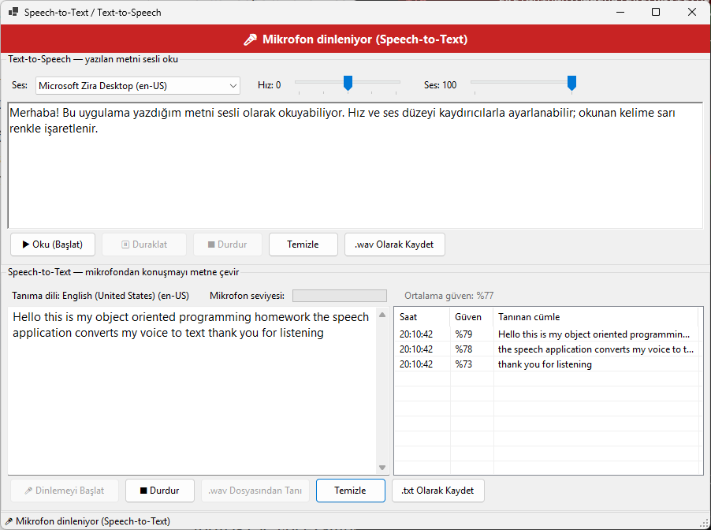

# YMH219-SpeechApp — Speech-to-Text ve Text-to-Speech

Ses ve metin arasında çift yönlü dönüşüm yapan Windows Forms uygulaması. Kullanıcı yazdığı metni
sesli okutabilir (TTS) ve mikrofondan alınan konuşmayı metne dönüştürebilir (STT).
Windows'un yerleşik konuşma altyapısı (SAPI) `System.Speech` kütüphanesi üzerinden kullanılır.
Nesne Tabanlı Programlama (YMH 219) dersi ek uygulama ödevidir.

| | |
|---|---|
| **Öğrenci** | Abdulkadir Demir |
| **Öğrenci numarası** | 240541007 |
| **Ders** | Nesne Tabanlı Programlama (YMH 219) |

## Ekran Görüntüleri

| Metin okunuyor — okunan kelime sarı işaretli | Mikrofon dinleniyor — tanınan cümleler, saat ve güven skoru |
|---|---|
|  |  |

Üstteki renkli şerit o an hangi işlemin aktif olduğunu gösterir (gri: hazır, mavi: okunuyor,
turuncu: duraklatıldı, kırmızı: mikrofon dinleniyor, mor: ses dosyası tanınıyor).
Ekran görüntüsündeki tanıma sonuçları, uygulamanın **.wav Dosyasından Tanı** özelliğiyle bir İngilizce ses dosyasından üretilmiştir.

## Kullanılan Teknolojiler / NuGet Paketleri

- C# 12, .NET 8 (`net8.0-windows`), Windows Forms
- **NuGet:** [`System.Speech`](https://www.nuget.org/packages/System.Speech) 8.0.0
  - `SpeechSynthesizer` — metni sese çevirme, ses seçimi, hız, ses düzeyi, duraklat/devam
  - `SpeechRecognitionEngine` + `DictationGrammar` — serbest dikte ile konuşma tanıma
- `StreamWriter` ile .txt kaydı

## Kurulum ve Çalıştırma

Gereksinim: Windows 10/11, [.NET 8 SDK](https://dotnet.microsoft.com/download/dotnet/8.0) veya Visual Studio 2022,
konuşma tanıma için bir mikrofon.

```powershell
git clone https://github.com/kdemirwarehouse/YMH219-SpeechApp.git
cd YMH219-SpeechApp
dotnet run --project src/SpeechApp
```

Visual Studio ile: `SpeechApp.sln` → başlangıç projesi `SpeechApp` → **F5**.
NuGet paketi ilk derlemede otomatik indirilir.

**Testler:** `dotnet run --project tests/SpeechApp.Tests` (11 test)

**Mikrofon izni:** Windows Ayarlar → Gizlilik ve güvenlik → Mikrofon → *Masaüstü uygulamalarının mikrofona erişmesine izin ver* açık olmalıdır.

**Dil:** Uygulama kurulu tanıyıcılar arasından önce sistem dilini (ör. `tr-TR`), yoksa aynı dili, yoksa `en-US`'i seçer;
seçilen dil arayüzde gösterilir. Okuma sesleri de "Ses" listesinden seçilir.

## Temel Özellikler

**Text-to-Speech**
- Metin kutusundaki yazıyı **Oku (Başlat)**, **Duraklat / Devam**, **Durdur**, **Temizle**
- Okunan kelime anlık olarak **sarı** vurgulanır (`SpeakProgress` olayı)
- **Ses seçimi**, **hız** (-10…10) ve **ses düzeyi** (0…100) ayarı
- Metni **.wav** ses dosyası olarak kaydetme

**Speech-to-Text**
- **Dinlemeyi Başlat / Durdur** — mikrofondan sürekli dikte
- Tanınan cümleler metin alanına eklenir; ayrıca **saat ve güven skoru** ile listelenir
- Konuşma sürerken ara tahmin ("Duyulan: ...") ve **mikrofon seviyesi** çubuğu
- Çok düşük güvenli (gürültü) sonuçlar ayıklanır
- **.wav dosyasından tanıma** (mikrofonsuz deneme için)
- Sonuçları zaman damgasıyla **.txt** dosyasına kaydetme

**Hata yönetimi**
- Mikrofon yoksa / erişim izni kapalıysa anlaşılır mesaj (nasıl açılacağıyla birlikte)
- Kurulu konuşma tanıyıcı yoksa uyarı; tanıma sırasında hata olursa bildirim
- Boş metin okutulmaya çalışılırsa bilgilendirme; dosya yazma hataları yakalanır
- Okuma ve tanıma aynı anda çalışmaz (biri başlarken diğeri durdurulur)

## Proje Yapısı

```
YMH219-SpeechApp/
├── SpeechApp.sln
├── src/
│   ├── SpeechApp.Core/         System.Speech'ten bağımsız, test edilebilir mantık
│   │   ├── SesDurumu.cs        Aktif işlem durumu (enum) + açıklamaları
│   │   ├── TanimaGecmisi.cs    Tanınan cümleler, güven filtresi, .txt kaydı
│   │   └── DilSecici.cs        Kurulu tanıyıcılar arasından dil seçimi
│   └── SpeechApp/
│       ├── KonusmaServisi.cs   SpeechSynthesizer + SpeechRecognitionEngine sarmalayıcısı (IDisposable)
│       ├── MainForm.cs         Kullanıcı etkileşimi
│       └── MainForm.Designer.cs
├── tests/SpeechApp.Tests/
└── docs/screenshots/
```

Ayrıntılı açıklama: [KOD-REHBERI.md](KOD-REHBERI.md)

## Bilinen Sınırlamalar / Geliştirme Notları

- `System.Speech` yalnızca **Windows**'ta çalışır.
- Windows'un klasik masaüstü konuşma tanıyıcısı (SAPI) çoğu sistemde yalnızca **İngilizce (en-US)** olarak kuruludur;
  Türkçe tanıyıcı yoksa uygulama İngilizce tanıma yapar ve bunu arayüzde gösterir. Türkçe okuma için de bir Türkçe ses (ör. Microsoft Tolga) kurulu olmalıdır.
- Dikte doğruluğu mikrofon kalitesine ve ortam gürültüsüne bağlıdır.
- Daha iyi Türkçe destek için Azure Speech veya Vosk gibi bir servis/kütüphane kullanılabilir.
